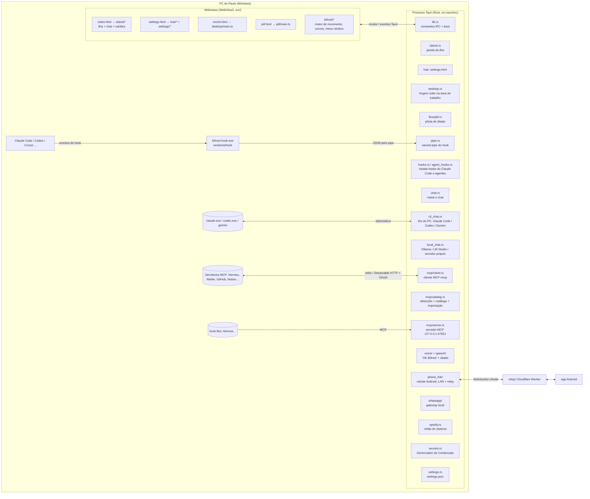

# Bifrost — engenharia reversa e especificação

> Documento gerado em 26/10/2026 (horário de Manaus) a partir do código em `windows/`
> (Tauri 2 + Rust + TypeScript), do hook (`windows/hook`), do relay (`relay/`) e do app
> macOS de referência (`NotchBuddy/`). Serve como especificação do Bifrost e como lista de
> paridade: cada função, comando IPC, evento, ajuste e estado está listado abaixo com o
> resultado da verificação.

## 1. Arquitetura

### Fluxos principais
1. **Sessão de agente**: Claude Code dispara hook → `bifrost-hook.exe` → named pipe (`pipe.rs`) → `island.rs` emite evento → `island/agents.ts` cria/atualiza pílula, cartão de aprovação/pergunta, e o Huginn muda de estado (`working`, `approval`, `question`, `finished`, `error`…).
2. **Aprovação**: cartão na ilha → `approval_ack` / `approval_decline` → resposta volta ao hook pelo pipe.
3. **Chat**: `views/chat.ts` → `chat_send` → `chat.rs::send` → provedor (`cli` = IA do PC, `mcp` = Hermes/outro agente, `ollama`/`lmstudio`/`custom` = modelo local). Provedores com chave (anthropic/openai/google/openrouter) continuam no código só para migração e são trocados por `cli` na abertura.
4. **MCP**: na abertura `bifrost_boot_mcp` detecta programas (PATH + pastas), monta o catálogo (`mcp/catalog.rs`), importa os servidores de Claude Desktop / Claude Code / Cursor / VS Code e junta em `mcpServers` sem sobrescrever nada e sem trazer de volta o que o usuário removeu (`mcpKnown`). Tokens de cabeçalhos importados vão para o cofre.
5. **Ditado (Flow)**: atalho → `flow/` grava (`speech/audio.rs`), transcreve, limpa (`flow/cleanup.rs`) e cola (`flow/paste.rs`); a pílula (`pill.html`) mostra o nível do microfone.
6. **Celular**: `phone_link/` anuncia na LAN (`discovery.rs`), pareia com código (`pairing.rs`), espelha sessões/chat/resumo; fora da rede usa o relay (`relay_client.rs` + `relay_crypto.rs`).
7. **WhatsApp**: gateway local instalado e controlado por `whatsapp/` (processo, webhook, arquivo de conversas).

## 2. Mapa de módulos

### Rust (`windows/src-tauri/src`)
| Arquivo | Linhas | Papel (do cabeçalho do arquivo) |
|---|---|---|
| `src-tauri/src/agent_hooks.rs` | 143 | Whether each hook-driven pill is connected. A pill fed by hook events has no key: it is connected once the agent's config routes its events to bifrost-hook (Mac #183 — th |
| `src-tauri/src/agents.rs` | 1310 | Hook and plugin installers for every agent other than Claude Code (hooks.rs). Each agent is a list of file edits handed to config_file.rs, which applies the |
| `src-tauri/src/chat.rs` | 412 | The chat, whoever answers it: the conversation, the system prompt, and which provider a turn goes to. Each provider's own wire format lives in its module: |
| `src-tauri/src/claude.rs` | 416 | Claude API client — the same integration as ClaudeService.swift: multi-turn chat with web search, and files sent as document/image/text blocks. |
| `src-tauri/src/cli_chat.rs` | 115 | O chat pelas IAs instaladas no PC, sem chave de API: Claude Code, Codex CLI ou Gemini CLI, cada um com o login que o próprio programa já tem. |
| `src-tauri/src/codex_plan.rs` | 219 | Codex plan usage — the same source as CodexPlanGauge.swift on the Mac. Bifrost asks the Codex CLI itself: `codex app-server` (the JSON-RPC server |
| `src-tauri/src/config_file.rs` | 652 | The one careful way Bifrost changes a file that belongs to somebody else: Claude Code's settings.json, every other agent's hook config, and the plugin |
| `src-tauri/src/desktop.rs` | 1011 | Huginn on the desktop: his own small window, wherever the user dropped him. Window side of DesktopMochi.swift, plus the geometry half of DesktopMochiLogic.swift (`logic`  |
| `src-tauri/src/files.rs` | 200 | Dropped files are copied into %LOCALAPPDATA%\Bifrost\inbox so the original is never touched and the copy survives the drag source going away. |
| `src-tauri/src/flow/cleanup.rs` | 97 | The clean-up of Flow dictation: Claude removes the "um", the repeats and the corrections said on the way ("at 3, no, at 4" → "at 4"), fixes the |
| `src-tauri/src/flow/logic.rs` | 273 | The key logic of Flow dictation, with nothing from the OS in it. Port of FlowKeyLogic.swift. - Hold the key: Bifrost listens. Release it: the words are pasted where you t |
| `src-tauri/src/flow/mod.rs` | 706 | Flow dictation: hold a key anywhere, speak, let go, and the words are pasted where you type. Port of FlowDictation.swift for Windows and Linux. |
| `src-tauri/src/flow/os_linux.rs` | 263 | Flow dictation on Linux. On X11: the key through XInput 2's raw key events (they reach every client without grabbing anything, so no key is ever taken |
| `src-tauri/src/flow/os_windows.rs` | 283 | Flow dictation on Windows: the key, through a low-level keyboard hook (it only watches, it never swallows a key); the paste, through SendInput; and |
| `src-tauri/src/flow/paste.rs` | 73 | The words go where you type: onto the clipboard (kept out of the clipboard history), Ctrl+V in the app in front, and the clipboard gets back what it |
| `src-tauri/src/flow/pill.rs` | 356 | The pill of Flow dictation: a small see-through capsule at the bottom of the screen (or on its left or right edge) while dictation is on. It opens into |
| `src-tauri/src/flow/store.rs` | 392 | Everything the Bifrost window shows and edits about dictation: the history, the numbers, the dictionary, the snippets, the styles and the preferences. |
| `src-tauri/src/flow/text.rs` | 350 | What Bifrost does to the words before pasting them, and the numbers of the Statistics page. Port of FlowText.swift; nothing here touches the OS, so it |
| `src-tauri/src/flow/wayland.rs` | 203 | Flow dictation on Wayland, where no app may watch the keyboard or type into another one. The key: a shortcut held through the desktop's GlobalShortcuts portal |
| `src-tauri/src/github.rs` | 799 | GitHub pulse and contribution calendar — the pure half of GithubPoller.swift, GitHubPulse.swift and GitHubActivity.swift. Parsing, alert detection and the |
| `src-tauri/src/hooks.rs` | 580 | Claude Code hook installation. The rule from CLAUDE.md is strict and is followed to the letter: read %USERPROFILE%\.claude\settings.json, take a dated backup, merge witho |
| `src-tauri/src/i18n.rs` | 336 | Interface language for what Rust shows: the tray menu, the settings window title and the errors the webviews display. Same tables and same lookup as |
| `src-tauri/src/identity.rs` | 67 | The user's first name, for Huginn's system prompt — the same rules as UserIdentity.swift on the Mac. The full name comes from the OS account (platform::user_full_name); t |
| `src-tauri/src/integrations.rs` | 1315 | Integration pollers — the Rust side of StripePoller / GithubPoller / VercelPoller / N8nPoller / ResendPoller / NotionPoller / CalcomPoller. Same endpoints, same first-run |
| `src-tauri/src/island.rs` | 542 | Island window: placement on the chosen display, the two window sizes (full panel / invisible wake strip), click-through and the cursor poll. There is no notch on a PC, so |
| `src-tauri/src/lib.rs` | 1309 | Bifrost for Windows — app wiring and the commands the island calls. |
| `src-tauri/src/local_chat.rs` | 572 | Chat with a model server the user runs: Ollama, LM Studio, or any other server that speaks the OpenAI API (vLLM, llama.cpp, Unsloth…) — the same |
| `src-tauri/src/log.rs` | 32 | Small append-only log at %LOCALAPPDATA%\Bifrost\bifrost-desktop.log (Windows) or ~/.local/share/bifrost-desktop/bifrost-desktop.log (Linux) — the equivalent of nbLog() in |
| `src-tauri/src/main.rs` | 6 | Bifrost runs without a console window: Huginn is the whole UI. |
| `src-tauri/src/mcp/catalog.rs` | 488 | Catálogo do Bifrost: os servidores MCP que já vêm prontos, a detecção dos programas e IAs instalados no PC e a importação dos servidores que outros |
| `src-tauri/src/mcp/chat.rs` | 228 | The "mcp" chat provider: no API key, the message goes to an agent through a tool of an MCP server picked in the settings (`mcpChat`). Two modes: |
| `src-tauri/src/mcp/client.rs` | 267 | The MCP client: one live connection per configured server, opened on first use and kept until its configuration changes or it closes. |
| `src-tauri/src/mcp/config.rs` | 246 | The MCP servers Bifrost may talk to, as written in settings.json: "mcpServers": { "hermes":     { "command": "hermes.exe", "args": ["mcp-serve", "--tools"], "env": {} }, |
| `src-tauri/src/mcp/mod.rs` | 19 | MCP (Model Context Protocol) — the Paulo build of Bifrost. Instead of API keys, the chat can talk to agents through MCP servers the user configures (Hermes, Alethe, Orca, |
| `src-tauri/src/mcp/server.rs` | 526 | Bifrost's own MCP server: lets Grok Bot, Hermes, Alethe… drive Huginn. Streamable HTTP on 127.0.0.1 only (`http://127.0.0.1:<port>/mcp`), and every |
| `src-tauri/src/net.rs` | 285 | Network helpers shared by the chat providers: address checks, bounded reads and HTTP clients. Every answer a server sends is read with a ceiling, so a misbehaving or |
| `src-tauri/src/notes/builder.rs` | 382 | Builds the transcript of a call from the two recordings: the microphone is you, the computer's sound is the others, told apart by the diarizer. Port of |
| `src-tauri/src/notes/mod.rs` | 718 | The Notetaker: records a call (your microphone, and what the computer plays for the other people), shows a live transcript, then writes the whole |
| `src-tauri/src/openai_compat.rs` | 420 | Cloud providers that speak the OpenAI chat completions API: OpenAI, Google AI (Gemini's OpenAI-compatible endpoint, as ClaudeService.swift uses it) and |
| `src-tauri/src/phone_link/admission.rs` | 290 | Who may open a connection, and for how long it may stay unauthenticated (docs/ANDROID_LINK.md, "Admission"). The server accepts connections from the local network before  |
| `src-tauri/src/phone_link/chat.rs` | 419 | Chat from the phone (docs/ANDROID_LINK.md, "Chat"). The phone sends text, this computer asks the provider with ITS key, and the answer comes back as small `chatDelta` lin |
| `src-tauri/src/phone_link/chat_backend.rs` | 207 | The real chat behind the phone link (chat.rs holds the rules): the same provider code as the island's chat, with the phone's own conversation. The key is read inside `cla |
| `src-tauri/src/phone_link/discovery.rs` | 272 | Announces this computer on the local network while the phone link is on, so the phone finds it by itself when its address changes (another Wi-Fi, a hotspot). mDNS / DNS-S |
| `src-tauri/src/phone_link/hub.rs` | 2239 | What the phone is told, and what it may decide. The hub holds the last list of sessions and the one permission request that is still waiting, as the island published them |
| `src-tauri/src/phone_link/interop.rs` | 224 | The real phone link server, run for the Android app's tests. Not a test of its own: it is `#[ignore]`d, and android/.../RustDesktopInteropTest.kt |
| `src-tauri/src/phone_link/mod.rs` | 904 | Copyright (c) 2026 Rhytam Biswas. MIT License, like the rest of Bifrost; see android/LICENSE for the text. The phone link: lets the Android app ("Bifrost for Android") se |
| `src-tauri/src/phone_link/pairing.rs` | 330 | The phone link's identity: a TLS certificate made once, and the pairing token. Both live in the OS keystore (Credential Manager, Secret Service), never in a |
| `src-tauri/src/phone_link/relay_client.rs` | 1068 | The phone link through a relay (docs/RELAY_LINK.md), computer side. Off unless the user turns on "Away from home Wi-Fi" in Settings → Android phone and gives a relay addr |
| `src-tauri/src/phone_link/relay_crypto.rs` | 770 | The end-to-end encrypted channel for the relay link (docs/RELAY_LINK.md, sections 4 and 5). Pure: bytes in, bytes out. No sockets, no clock, no files, no logging. The rel |
| `src-tauri/src/phone_link/server.rs` | 457 | The phone link's TLS server (docs/ANDROID_LINK.md, protocol v1). One accepted connection is two tasks: a reader that checks the phone's lines |
| `src-tauri/src/pipe.rs` | 370 | Relay server for bifrost-hook. Windows: the named pipe `\\.\pipe\bifrost-desktop-<sid>`, one instance per connection. Linux: the Unix socket `$XDG_RUNTIME_DIR/bifrost-des |
| `src-tauri/src/platform/linux.rs` | 939 | Linux: XDG directories for files, xdg-open for links and folders, and gtk-layer-shell for the island window. Wayland gives an app no global cursor position and no say ove |
| `src-tauri/src/platform/linux_focus.rs` | 565 | Linux "Open terminal": bringing a session's terminal or editor window forward. session_window.rs keeps, per session, the relay's ancestors read from /proc |
| `src-tauri/src/platform/mod.rs` | 90 | Everything that differs between operating systems, behind one set of names. The rest of the app calls `platform::…` and never touches Win32 or a Linux |
| `src-tauri/src/platform/windows.rs` | 643 | Windows: Win32 for the island window and the cursor, %APPDATA% for files. |
| `src-tauri/src/portal.rs` | 910 | Global shortcuts on Wayland, through the XDG desktop portal (org.freedesktop.portal.GlobalShortcuts): KDE Plasma 6, GNOME 48+, Hyprland's portal, COSMIC… |
| `src-tauri/src/recap.rs` | 1049 | Weekly recap history — port of RecapStore.swift. Every hook event the relay forwards also passes through here. A "turn" runs from a prompt (or the first tool call) to Sto |
| `src-tauri/src/secrets.rs` | 185 | API keys live in the Windows Credential Manager or, on Linux, the Secret Service (GNOME Keyring, KWallet) — never on disk and never in the front end — the island can only |
| `src-tauri/src/session_window.rs` | 404 | "Open terminal" brings the window a Claude Code session runs in to the front, instead of opening its folder in VS Code (Mac 0.1.0: jump to the terminal). |
| `src-tauri/src/settings.rs` | 1077 | Preferences, stored as plain JSON in settings.json under platform::config_dir(). No secret ever lands here — API keys live in the OS keychain (see secrets.rs). |
| `src-tauri/src/shortcuts.rs` | 861 | Global keyboard shortcuts — port of HotKeyCenter.swift + ShortcutLogic.swift. The shortcuts are registered from Rust through tauri-plugin-global-shortcut |
| `src-tauri/src/sounds.rs` | 100 | Your own sounds: a file named like one of Huginn's sounds in the sounds folder replaces it (finish.wav, approval.mp3, greet.m4a…), as on the Mac |
| `src-tauri/src/speech/audio.rs` | 555 | Sound in: the microphone (or what the computer plays, for the Notetaker) turned into 16 kHz mono for the models, the nine bands the pill draws, and |
| `src-tauri/src/speech/mod.rs` | 478 | Speech to text on this computer: NVIDIA's Parakeet (25 languages) through sherpa-onnx, and the small models that tell the voices of a call apart. The |
| `src-tauri/src/spotify.rs` | 2106 | The Spotify pill — port of SpotifyController.swift. The Mac listens to Spotify's distributed notification and drives it over AppleScript. Linux has MPRIS instead: Spotify |
| `src-tauri/src/tray.rs` | 168 | Notification-area icon: Open, Weekly recap, Adornments, Settings, Pause, Quit. "Update Bifrost to X…" shows under Open only while a new version is out |
| `src-tauri/src/update.rs` | 1024 | "Bifrost 0.6.0 is out" in the island, and on Windows one click to install it. Port of MacUpdate.swift / MacUpdater.swift (the Mac's GitHub build). |
| `src-tauri/src/voice/brain.rs` | 228 | « OK Bifrost »'s brain: Claude with the user's key and Bifrost's tools — pills, music, the user's own data, opening an app, preparing an email (the |
| `src-tauri/src/voice/mod.rs` | 566 | « OK Bifrost » on Windows and Linux: say it, then ask anything. Port of the Mac's Voice/ (VoiceEngine.swift and its friends). While it is on, the microphone is open and a |
| `src-tauri/src/voice/wake.rs` | 239 | « OK Coucou »: hearing the wake phrase in what Parakeet wrote, and telling speech from silence on the microphone. Nothing here touches the OS. |
| `src-tauri/src/webview_drop.rs` | 87 | Files dropped on the island, taken by WebView2 itself. Tauri's drag-drop goes through drop targets wry registers on the webview's child windows. The innermost windows, th |
| `src-tauri/src/whatsapp/archive.rs` | 158 | Just enough of the zip format to take GOWA's binary out of the zip it publishes: the central directory, stored and deflated entries, nothing else (no zip64, no encryption |
| `src-tauri/src/whatsapp/gateway.rs` | 793 | What the two local WhatsApp gateways send and answer, turned into `Message`. Port of WhatsAppGateway.swift: every field name comes from each gateway's docs and source cod |
| `src-tauri/src/whatsapp/install.rs` | 182 | "Install WhatsApp": one click instead of GitHub, a zip and a command line (port of WhatsAppGOWAInstaller.swift). Downloads GOWA's own latest build for this system from it |
| `src-tauri/src/whatsapp/mod.rs` | 1329 | WhatsApp in the island (experimental), the Windows and Linux port of the Mac's WhatsAppController.swift. Talks to the local gateway the user runs (GOWA, which Bifrost can |
| `src-tauri/src/whatsapp/model.rs` | 578 | WhatsApp in the island: what Bifrost keeps of the conversations, in memory only, and the rules that decide what reaches the pill. Port of WhatsAppModels.swift (the Mac's  |
| `src-tauri/src/whatsapp/prefs.rs` | 106 | WhatsApp's harmless choices (Settings → Integrations → WhatsApp), in whatsapp.json next to settings.json. Owned by Rust: the webview changes them through `whatsapp_set_pr |
| `src-tauri/src/whatsapp/process.rs` | 189 | GOWA started by Bifrost ("Start GOWA automatically", or after "Install WhatsApp"): a child of Bifrost, on the address set in Settings, stopped when Bifrost quits. Port of |
| `src-tauri/src/whatsapp/provider.rs` | 451 | The two local WhatsApp gateways Bifrost can talk to (port of WhatsAppProvider.swift). Each call goes to the URL set in Settings (127.0.0.1 by default) and nowhere else: n |
| `src-tauri/src/whatsapp/webhook.rs` | 83 | The local door the WhatsApp gateway knocks on with each new message (port of WhatsAppWebhook.swift): an HTTP listener bound to 127.0.0.1 only, never reachable from anothe |

### TypeScript (`windows/src`)
| Arquivo | Linhas | Papel (do cabeçalho do arquivo) |
|---|---|---|
| `src/bifrost/contextmenu.ts` | 90 | Menu de contexto do Bifrost: o menu nativo do WebView2 nunca aparece. Onde um menu faz sentido (texto, campos, corvos) desenhamos o nosso, nórdico. |
| `src/bifrost/mascots.ts` | 83 | Huginn (pensamento) e Muninn (memória): os dois corvos de Odin, desenhados do zero em SVG para o Bifrost. Cada estado é uma classe CSS em nordic.css |
| `src/bifrost/motion.ts` | 89 | Motor de movimento do Bifrost: curvas próprias, molas e linhas do tempo. Mesmo princípio do motor do Huginn na ilha (alvos + duração + curva, tudo |
| `src/core/anim.ts` | 155 | Easing + spring helpers. Ease.* mirrors BotEngine.swift `enum Ease` (itself the prototype's `E`). Spring mirrors SwiftUI `.spring(response:dampingFraction:)` so open/clos |
| `src/core/bridge.ts` | 743 | Thin wrapper over the Tauri commands/events. Every call is a no-op when the page is opened in a plain browser, so the island can be iterated on with |
| `src/core/diff.ts` | 326 | Live diff — port of DiffEngine.swift (NotchBuddy/Sources/CoucouKit). Line diff (LCS) with 3-line context hunks, used for the Edit / MultiEdit / |
| `src/core/flow.ts` | 241 | Flow dictation, the voice models and the Notetaker, as the Bifrost window and the pill see them (src-tauri/src/flow, speech, notes). |
| `src/core/fonts.ts` | 9 | Fonts that carry the scripts of the ten interface languages, appended to the existing stacks before the generic family. Latin and Cyrillic text keeps |
| `src/core/github.ts` | 312 | GitHub pulse and contribution grid — the pure half of the GitHub card. Port of the helpers around GitHubPulseCardView, GitHubDetailView and GitHubActivityDetailContent (I |
| `src/core/layout.ts` | 260 | Island geometry — ported from IslandTypes.swift + IslandWindowController.islandSize + IslandRootView.botPosition. All values are logical pixels, identical to the |
| `src/core/mcp.ts` | 113 | MCP (Paulo build): pure helpers for the "Servidores MCP" settings, so they can be tested without a webview. The Rust side (mcp/config.rs) checks again. |
| `src/core/phone-chat.ts` | 40 | Settings → Android phone → chat: which models the phone may use. Pure helpers, so the rules can be tested without a webview. Rust cleans the list again (phone_link/chat_b |
| `src/core/pill-colors.ts` | 58 | A colour of your own for each pill's Huginn — the pure half, port of NotchBuddy/Sources/CoucouKit/PillColors.swift. The catalog (./pills.ts) keeps |
| `src/core/pills.ts` | 255 | Every pill the island can show — port of PillCatalog.swift, the single source of truth on macOS. IDs, names, colours, categories and subtitles are the Mac's, |
| `src/core/plan.ts` | 224 | Plan usage gauges — the logic of ClaudePlanGauge.swift and CodexPlanGauge.swift on the Mac, with no DOM so it can be tested on its own. The pills and cards |
| `src/core/providers.ts` | 114 | Who the chat can talk to — the island's side of chat.rs. The Mac's ChatProvider (IslandTypes.swift) plus OpenRouter and any OpenAI-compatible |
| `src/core/shortcuts.ts` | 410 | Keyboard shortcuts — the pure part, port of ShortcutLogic.swift. Global shortcuts are registered by Rust (src-tauri/src/shortcuts.rs), which owns the same table of defaul |
| `src/core/sound.ts` | 166 | SoundEngine — port of SoundEngine.swift. Os 29 WAVs são os sons originais do Bifrost (windows/sounds, SOUNDS_DIR em vite.config.ts); they are served at /sounds/<name>.wav |
| `src/core/spotify.ts` | 121 | The Spotify pill on the page: what src-tauri/src/spotify.rs reports (MPRIS on Linux, the system media controls on Windows), and the pure rules the views and Huginn follow |
| `src/core/state.ts` | 517 | App state — mirror of AppState.swift (the parts the island needs). |
| `src/core/update.ts` | 78 | New versions of Bifrost (src-tauri/src/update.rs): what Rust reports, and the small rules the island applies to it. Pure, so tests/update.test.mjs checks them. |
| `src/core/whatsapp.ts` | 295 | WhatsApp (experimental) on the page: what src-tauri/src/whatsapp reports, and the pure rules the card and Settings follow — ports of WhatsAppModels.swift (initials, previ |
| `src/desktop/main.ts` | 366 | The desktop Huginn's own window (mochi.html): draws him, and turns clicks and drags on him into pokes, flights home, the wardrobe and a new spot. Port of |
| `src/hub/frames.ts` | 25 | When the Bifrost window's canvases are drawn (hub/hero.ts), kept apart from the DOM so it can be tested. The rule is the island's: nothing on screen, |
| `src/hub/hero.ts` | 483 | The coloured band on top of each page of the Bifrost window: a deep black with the page's colour breathing in a corner, particles that drift all the |
| `src/hub/pages.ts` | 22 | The Flow pages of the Bifrost window, by id (shell.ts draws the Notch ones from the island's settings). |
| `src/hub/pages/dictation.ts` | 148 | Dictation: today's dictations with search and copy, the big numbers, and the way to the Notetaker. Until dictation is set up, the steps to get there. |
| `src/hub/pages/flowsettings.ts` | 154 | Flow → Settings: the key, where the pill is, the microphone, the voice model, the Notetaker's summaries, the window and the history. Port of FlowHubSettings.swift. |
| `src/hub/pages/insights.ts` | 78 | Statistics: words, time saved, speed, dictations, the words of each day and the apps you dictate in. Port of FlowHubInsights.swift. |
| `src/hub/pages/notes.ts` | 264 | The Notetaker: your calls, transcribed person by person, with a summary, the key points and the to-dos. Port of FlowHubNotes.swift. |
| `src/hub/pages/styles.ts` | 79 | Styles: an optional clean-up by Claude (no "um", no repeats, corrections applied), as said, natural or polished, per app. Port of the styles part of |
| `src/hub/pages/voice.ts` | 84 | « OK Bifrost »: say it, then ask anything. Turning it on, how Bifrost answers out loud, and what leaves the computer. Port of the Mac's Settings → Voice. |
| `src/hub/pages/words.ts` | 155 | Dictionary (names Bifrost always spells right, and replacements) and Snippets (say a short phrase, paste a whole text). Port of FlowHubWords.swift. |
| `src/hub/shell.ts` | 202 | The Bifrost window: a sidebar with Flow (dictation, the Notetaker, the statistics, the dictionary, the snippets, the styles and their settings) |
| `src/hub/ui.ts` | 157 | Small pieces the Bifrost window's pages are drawn with: icons, rows, cards, switches, segmented controls. Same look as the Mac's (FlowHub.swift). |
| `src/i18n/i18n.ts` | 270 | Interface language — the Mac's languages except Thai and Traditional Chinese, Mac-only for now. Strings are looked up by their English text, like the Mac's catalog: |
| `src/island/agents.ts` | 52 | Agents other than Claude Code, as the island shows them. Ids, names and colours are PillCatalog.swift's (pill `agent_<id>`), so a pill looks the same on every |
| `src/island/desktop.ts` | 181 | Huginn on the desktop, island side: runs his life cycle (the controller in mochi/desktop-logic.ts) against the real app, tells the desktop window what |
| `src/island/fsm.ts` | 213 | Island open/close FSM — port of IslandStateMachine.swift. No DOM, no Tauri: it only reports transitions. |
| `src/island/hooks.ts` | 538 | Hook events from Claude Code and every other agent → island state. Port of HookServer.processEvent / processPermissionRequest from the macOS app. |
| `src/island/integrations.ts` | 138 | Integration events → island state. Port of the `handle…` methods in the Swift pollers: a genuinely new item flips the pill to finished/error, badges it when |
| `src/island/island.ts` | 1286 | The island: DOM shell, sizing animation, Huginn placement, mouse handling. Mirrors IslandRootView.swift + IslandWindowController.swift. |
| `src/island/phone-link.ts` | 262 | What the island tells the phone link (src-tauri/src/phone_link). While the link is on, the island publishes a picture of its agent sessions and |
| `src/island/phone-services.ts` | 128 | What the island's service pills show, written as small read-only cards for the phone (docs/ANDROID_LINK.md, "Service cards"). Rust sends a phone only the services its use |
| `src/island/shortcuts.ts` | 213 | Keyboard shortcuts → island. Port of IslandWindowController.handleHotKey and handleIslandKey from the macOS app. Global shortcuts are caught by Rust and arrive as a `shor |
| `src/island/spotify.ts` | 58 | Spotify's reports → the page (src-tauri/src/spotify.rs). The parts of SpotifyController.swift that touch the app: the pill wears the track's title, music starting shows t |
| `src/island/update.ts` | 158 | New versions in the island — port of MacUpdater's card side. Rust (src-tauri/src/update.rs) does the looking, the downloading and the schedule; it offers the card ("updat |
| `src/island/voice.ts` | 123 | « OK Bifrost » asks the island what only it knows (src-tauri/src/voice): the pills, to add, remove or pick the main one, and the user's own data for |
| `src/island/whatsapp.ts` | 93 | WhatsApp's reports → the page (src-tauri/src/whatsapp). The parts of WhatsAppController.swift that touch the island: a new message lights the pill with the conversation's |
| `src/main.ts` | 197 | Entry point: boot the bridge, wire the island, start the greeting. |
| `src/mochi/desktop-logic.ts` | 330 | Huginn on the desktop — the pure logic, port of NotchBuddy/Sources/App/DesktopMochiLogic.swift and of the life cycle in DesktopMochiController (DesktopMochi.swift). No DO |
| `src/mochi/engine.ts` | 1475 | Huginn — o corvo mensageiro do Bifrost, desenhado em código (Canvas 2D). O motor de estados/animações (tweens, partículas, emotes) segue o do app |
| `src/mochi/greeting.ts` | 717 | The launch "bifrost-desktop" (greeting v2) — port of GreetingCanvasView.swift. Huginn drops into the island, bounces, slides to the side and waves hello with |
| `src/mochi/minibots.ts` | 99 | Mini Huginns (pills + compact grid) — port of MiniBotCanvasView. Each canvas owns a BotEngine; the island's frame loop ticks every live one. |
| `src/mochi/outfits.ts` | 354 | Adornos do Huginn, desenhados em código — originais do Bifrost: halo de aurora, faixa de runas, cachecol de gelo, coroa de estrelas, elmo e lanterna. |
| `src/mochi/wardrobe.ts` | 131 | Os adornos do Huginn — a lógica pura. Escolhidos na vista "Adornos" (clique direito no Huginn, ou no menu da bandeja) e guardados nas preferências como |
| `src/pill/main.ts` | 529 | Flow dictation's pill (pill.html). Port of FlowPillView (FlowPill.swift). What it shows comes whole from Rust in `pill-state` events; the nine dots |
| `src/recap/phone.ts` | 35 | The weekly recap as the phone gets it (cap `recap`, docs/ANDROID_LINK.md): the numbers of the last completed week and the busiest agent's name. Pure: no DOM, no Tauri; te |
| `src/recap/recap.ts` | 87 | Weekly recap — when the card opens, and what it shows. Port of AppDelegate.checkMondayRecap / openWeeklyRecap. It opens on its own once a week, on Monday from 8 am, at th |
| `src/recap/share.ts` | 294 | The 1080 × 1920 image of the week, drawn once into an offscreen canvas — port of RecapShareImageView in WeeklyRecapView.swift. Same colours, sizes |
| `src/recap/summary.ts` | 253 | Weekly recap — pure aggregation, port of RecapStore.weeklySummary. Rust (src-tauri/src/recap.rs) records the turns; this file turns them into |
| `src/settings/agents.ts` | 143 | Settings → Agents: one section for every agent other than Claude Code, all going through the same steps — preview the exact diff, click to confirm, and |
| `src/settings/colors.ts` | 101 | The colour dot at the start of a pill's row, and the palette it opens — the Mac's dot in Settings → Active pills does the same. The dot looks exactly as |
| `src/settings/main.ts` | 1237 | The Bifrost window (settings.html): Flow dictation, the Notetaker and, under Notch, every setting of the island — the place where anything that writes to |
| `src/settings/mcp.ts` | 442 | Settings → Chat → "Servidores MCP" (Paulo build): the agents the chat talks to without keys, how the chat reaches one of them, and Bifrost's own MCP |
| `src/settings/parts.ts` | 16 | Small pieces every settings section draws with. |
| `src/settings/phone.ts` | 550 | Settings → Android phone: the switch for the phone link and the code that pairs a phone with this computer. Off until the user turns it on. |
| `src/settings/updates.ts` | 75 | Settings → General → Updates — port of UpdateSettingsSection (MacUpdateViews.swift): the toggle, what it does, "Check now" (a click, so it works with the toggle off), and |
| `src/settings/whatsapp.ts` | 328 | Settings → Integrations → WhatsApp (experimental) — a port of WhatsAppSettingsSection (WhatsAppViews.swift). Off until turned on. "Install WhatsApp" downloads GOWA from i |
| `src/upload/canvas.ts` | 602 | The upload canvas — port of UploadCanvasView.swift. While the sequence engine is active this canvas draws the whole island body: card, dashed drop frame, drop text, progr |
| `src/upload/sequence.ts` | 528 | The drop choreography — port of UploadSequenceEngine.swift, itself a port of design/prototype/upload-sequence.html. The engine is pure arithmetic: it owns no DOM and draw |
| `src/views/chat.ts` | 352 | Chat view — DOM port of PromptView / ChatBubble / TypingDotsView / ModelPickerView from IslandViewContent.swift. Answers are rendered as Markdown (markdown.ts). A local m |
| `src/views/diff.ts` | 67 | Diff card — port of DiffCardView / DiffLineRowView (IslandViewContent.swift). Opens in the overview's left card when a diff step of the ticker is clicked. |
| `src/views/dom.ts` | 145 | Minimal DOM helpers — no framework, as specified. |
| `src/views/github.ts` | 251 | The GitHub card once the pulse is in — DOM ports of GitHubPulseCardView, GitHubDetailView, GitHubPRRowView, GitHubRepoCIRowView and GitHubActivityDetailContent (IslandVie |
| `src/views/icons.ts` | 77 | SVG paths standing in for the SF Symbols used by the macOS island. Drawn on a 24×24 grid so they read at the same optical size. |
| `src/views/integrations.ts` | 520 | Integration cards shown in the overview's left card — DOM ports of IntegrationCardView and friends from IslandViewContent.swift. Cal.com is the one simplification: macOS  |
| `src/views/markdown.ts` | 266 | Markdown in the chat's answers, as on the Mac (ChatMarkdown.swift and ChatMarkdownView.swift): headings, paragraphs, fenced code with a copy button, |
| `src/views/recap.ts` | 243 | Weekly recap card and its share panel — port of WeeklyRecapCardView and RecapSharePanelView (WeeklyRecapView.swift). The Mac shares from a separate |
| `src/views/spotify.ts` | 431 | The Spotify pill and card — DOM ports of SpotifyPill / SpotifyCardView (SpotifyViews.swift) and the shared now-playing pieces (NowPlayingViews.swift |
| `src/views/ticker.ts` | 221 | Overview task ticker — port of TickerView (V2) from IslandViewContent.swift. Three rows: completed (A), current → completed (B), incoming (C). Every row |
| `src/views/update.ts` | 112 | The update card — port of UpdateCardView (MacUpdateViews.swift): the one-time question, "Bifrost X is out" with Update now · What's new · Later, |
| `src/views/upload.ts` | 124 | Drop zone, upload progress and the "what do you want to do with it" card — ports of UploadView / UploadingView / ChooseView from IslandViewContent.swift. |
| `src/views/usage.ts` | 214 | Plan usage in the island: the Claude and Codex pills in the header and the card behind each. Same behaviour as ClaudePlanHeaderPill, ClaudePlanCardView |
| `src/views/views.ts` | 854 | Island views — DOM ports of IslandViewContent.swift. Paddings, font sizes, colours and wording are copied from the Swift views so both platforms read |
| `src/views/wardrobe.ts` | 100 | Wardrobe view — port of WardrobeView (IslandViewContent.swift). Opened with a right-click on Huginn or from the tray menu. Resting the pointer on a button |
| `src/views/whatsapp.ts` | 258 | The WhatsApp card — a DOM port of WhatsAppCardView, WhatsAppRow, WhatsAppConversationView, WhatsAppBubble and WhatsAppAvatar (WhatsAppViews.swift). Sizes, colours and wor |
| `src/views/whatsnew.ts` | 108 | What's new after an update (whats-new/controller.ts decides when): first what this version brings — an icon, a title and a line per item — then |
| `src/whats-new/controller.ts` | 162 | What's new after an update — when the card opens. Once per version, a few seconds after Bifrost starts (after the greeting), and only when nothing |
| `src/whats-new/icons.ts` | 57 | The icons of the What's new card, as strokes on the 24×24 grid of views/icons.ts (drawn with svg(path, size, { stroke })). The Mac maps the same names to SF Symbols (What |
| `src/whats-new/whats-new.ts` | 196 | What's new after an update, and the blue Huginn while one waits — the rules, pure, so tests/whats-new.test.mjs checks them. The island side is in |

## 3. Janelas
| Rótulo | Página | O que faz |
|---|---|---|
| `island` | `index.html` → `src/main.ts` / `island/*` | Ilha no topo da tela: pílulas, Huginn, chat, cartões de aprovação/pergunta, recap, upload, Spotify, WhatsApp, atualizações. |
| `settings` | `settings.html` → `hub/*` + `settings/*` | Hub: Flow (Ditado, Notetaker, Estatísticas, Dicionário, Trechos, Estilos, Ajustes) e Notch (Geral, Abas ativas, Agentes, Chat, OK Bifrost, Integrações, Celular Android, Atalhos). |
| `mochi` (rótulo interno) | `mochi.html` → `desktop/main.ts` | Huginn solto na área de trabalho (arrastar, cutucar, guarda-roupa, voltar para casa). |
| `pill` | `pill.html` → `pill/main.ts` | Pílula do ditado. |
| bandeja | `tray.rs` | Menu da bandeja do sistema (nativo). |

## 4. Estados, animações e sons
* **Ilha (FSM, `island/fsm.ts`)**: `hidden` → `petit` → `home` → `bifrost-desktop`; abre no hover/atalho, fecha pelo intervalo `autoCloseInterval`.
* **Huginn na ilha (`mochi/engine.ts`, Canvas 2D)**: estados `idle, working, thinking, searching, approval, question, error, finished, ratelimit, sleeping, dizzy`; emotes `love, surprised, proud, wink, yawn, happy, annoyed`; tweens por propriedade (`yaw, pitch, roll, tilt, open, sx, sy, oy, ox, tint, morph, hands, blush…`) com curvas de `core/anim.ts`; partículas e mini-corvos (`mochi/minibots.ts`); roupas (`mochi/outfits.ts`, `wardrobe.ts`); saudação (`mochi/greeting.ts`).
* **Corvos SVG do Bifrost (`bifrost/mascots.ts`, NOVO)**: Huginn (azul-fiorde, runa ᚨ) e Muninn (ferro, runa ᛗ) com estados `idle` (respiração + piscar sorteado), `flyIn`, `flyOut` (bater de asas), `thinking` (três pontos de aurora), `listening` (ondas), `success` (pulo + check desenhado), `error` (tremor + runa ᚾ), `sleeping` (z).
* **Motor de movimento (`bifrost/motion.ts`, NOVO)**: curvas `fjord`, `raven` (ressalto), `tide`, `ember`, mola analítica, ritmo único `Beat` (120/220/360/620/1100 ms), `cascade()` para entrada em sequência; `prefers-reduced-motion` pula para o fim.
* **Efeitos (`bifrost/nordic.css`, NOVO)**: aurora que deriva, ponte arco-íris que flui, seções entalhadas com nó dourado, botões de ferro com fio de ouro (hover/clique), cartões que sobem em cascata, menu de contexto nórdico.
* **Sons (`core/sound.ts`, `sounds.rs`)**: peek,, open,, close,, hover,, blip,, slap,, annoyed,, dizzy,, greet,, work,, finish,, error,, approval,, question,, approve,, gulp,, tick,, send,, love,, pop,, proud,, wink,, yawn,, attach,, think,, search,, rate,, sleep,, greeting,.

## 5. Menus de contexto
* Menu nativo do WebView2 **desligado** em todas as janelas: `SetAreDefaultContextMenusEnabled(false)` (`webview_drop.rs::disable_native_menus`) + `contextmenu` com `preventDefault` global (`bifrost/contextmenu.ts`, importado pelas 4 páginas).
* Menu próprio: campos de texto (Recortar/Copiar/Colar/Selecionar tudo), texto selecionado (Copiar). Clique direito no Huginn continua abrindo o guarda-roupa.
* Bandeja: continua o menu nativo do Windows (limitação — ver §9).

## 6. Comandos IPC (173) — lista de paridade
| Comando | Situação | Verificação |
|---|---|---|
| `boot` | mantido | ✅ compila + `cargo test` (562) + `npm test` (475) |
| `save_settings` | mantido | ✅ compila + `cargo test` (562) + `npm test` (475) |
| `set_system_languages` | mantido | ✅ compila + `cargo test` (562) + `npm test` (475) |
| `set_collapsed` | mantido | ✅ compila + `cargo test` (562) + `npm test` (475) |
| `set_island_rect` | mantido | ✅ compila + `cargo test` (562) + `npm test` (475) |
| `focus_window` | mantido | ✅ compila + `cargo test` (562) + `npm test` (475) |
| `reposition` | mantido | ✅ compila + `cargo test` (562) + `npm test` (475) |
| `fit_zoom` | mantido | ✅ compila + `cargo test` (562) + `npm test` (475) |
| `hub_shown` | mantido | ✅ compila + `cargo test` (562) + `npm test` (475) |
| `list_monitors` | mantido | ✅ compila + `cargo test` (562) + `npm test` (475) |
| `open_url` | mantido | ✅ compila + `cargo test` (562) + `npm test` (475) |
| `open_gitlab_url` | mantido | ✅ compila + `cargo test` (562) + `npm test` (475) |
| `open_gitea` | mantido | ✅ compila + `cargo test` (562) + `npm test` (475) |
| `open_gitea_url` | mantido | ✅ compila + `cargo test` (562) + `npm test` (475) |
| `open_in_vscode` | mantido | ✅ compila + `cargo test` (562) + `npm test` (475) |
| `open_session` | mantido | ✅ compila + `cargo test` (562) + `npm test` (475) |
| `open_claude_desktop` | mantido | ✅ compila + `cargo test` (562) + `npm test` (475) |
| `open_file_in_vscode` | mantido | ✅ compila + `cargo test` (562) + `npm test` (475) |
| `quit_app` | mantido | ✅ compila + `cargo test` (562) + `npm test` (475) |
| `hooks_status` | mantido | ✅ compila + `cargo test` (562) + `npm test` (475) |
| `agent_hooks_status` | mantido | ✅ compila + `cargo test` (562) + `npm test` (475) |
| `hooks_preview` | mantido | ✅ compila + `cargo test` (562) + `npm test` (475) |
| `hooks_apply` | mantido | ✅ compila + `cargo test` (562) + `npm test` (475) |
| `agent_hooks_list` | mantido | ✅ compila + `cargo test` (562) + `npm test` (475) |
| `agent_hooks_preview` | mantido | ✅ compila + `cargo test` (562) + `npm test` (475) |
| `agent_hooks_apply` | mantido | ✅ compila + `cargo test` (562) + `npm test` (475) |
| `status_line_preview` | mantido | ✅ compila + `cargo test` (562) + `npm test` (475) |
| `status_line_apply` | mantido | ✅ compila + `cargo test` (562) + `npm test` (475) |
| `codex_plan_usage` | mantido | ✅ compila + `cargo test` (562) + `npm test` (475) |
| `approval_decision` | mantido | ✅ compila + `cargo test` (562) + `npm test` (475) |
| `approval_answer` | mantido | ✅ compila + `cargo test` (562) + `npm test` (475) |
| `approval_ack` | mantido | ✅ compila + `cargo test` (562) + `npm test` (475) |
| `approval_decline` | mantido | ✅ compila + `cargo test` (562) + `npm test` (475) |
| `log_line` | mantido | ✅ compila + `cargo test` (562) + `npm test` (475) |
| `chat_send` | mantido | ✅ compila + `cargo test` (562) + `npm test` (475) |
| `chat_models` | mantido | ✅ compila + `cargo test` (562) + `npm test` (475) |
| `local_connect` | mantido | ✅ compila + `cargo test` (562) + `npm test` (475) |
| `local_set_key` | mantido | ✅ compila + `cargo test` (562) + `npm test` (475) |
| `chat_reset` | mantido | ✅ compila + `cargo test` (562) + `npm test` (475) |
| `mcp_status` | mantido | ✅ compila + `cargo test` (562) + `npm test` (475) |
| `mcp_scan` | NOVO | ✅ compila + `cargo test` (562) + `npm test` (475) |
| `mcp_rescan` | NOVO | ✅ compila + `cargo test` (562) + `npm test` (475) |
| `mcp_save_server` | mantido | ✅ compila + `cargo test` (562) + `npm test` (475) |
| `mcp_remove_server` | mantido | ✅ compila + `cargo test` (562) + `npm test` (475) |
| `mcp_import` | mantido | ✅ compila + `cargo test` (562) + `npm test` (475) |
| `mcp_set_token` | mantido | ✅ compila + `cargo test` (562) + `npm test` (475) |
| `mcp_set_basic_auth` | mantido | ✅ compila + `cargo test` (562) + `npm test` (475) |
| `mcp_test` | mantido | ✅ compila + `cargo test` (562) + `npm test` (475) |
| `mcp_list_tools` | mantido | ✅ compila + `cargo test` (562) + `npm test` (475) |
| `mcp_set_chat` | mantido | ✅ compila + `cargo test` (562) + `npm test` (475) |
| `mcp_set_server` | mantido | ✅ compila + `cargo test` (562) + `npm test` (475) |
| `mcp_server_token` | mantido | ✅ compila + `cargo test` (562) + `npm test` (475) |
| `ingest_file` | mantido | ✅ compila + `cargo test` (562) + `npm test` (475) |
| `secret_present` | mantido | ✅ compila + `cargo test` (562) + `npm test` (475) |
| `secret_set` | mantido | ✅ compila + `cargo test` (562) + `npm test` (475) |
| `secret_clear` | mantido | ✅ compila + `cargo test` (562) + `npm test` (475) |
| `refresh_integration` | mantido | ✅ compila + `cargo test` (562) + `npm test` (475) |
| `github_refresh` | mantido | ✅ compila + `cargo test` (562) + `npm test` (475) |
| `n` | mantido | ✅ compila + `cargo test` (562) + `npm test` (475) |
| `open_settings_window` | mantido | ✅ compila + `cargo test` (562) + `npm test` (475) |
| `set_paused` | mantido | ✅ compila + `cargo test` (562) + `npm test` (475) |
| `shortcuts_status` | mantido | ✅ compila + `cargo test` (562) + `npm test` (475) |
| `shortcuts_suspend` | mantido | ✅ compila + `cargo test` (562) + `npm test` (475) |
| `phone_link::phone_link_status` | mantido | ✅ compila + `cargo test` (562) + `npm test` (475) |
| `phone_link::phone_link_set_enabled` | mantido | ✅ compila + `cargo test` (562) + `npm test` (475) |
| `phone_link::phone_link_pairing` | mantido | ✅ compila + `cargo test` (562) + `npm test` (475) |
| `phone_link::phone_link_new_pairing` | mantido | ✅ compila + `cargo test` (562) + `npm test` (475) |
| `phone_link::phone_link_publish` | mantido | ✅ compila + `cargo test` (562) + `npm test` (475) |
| `phone_link::phone_link_publish_question` | mantido | ✅ compila + `cargo test` (562) + `npm test` (475) |
| `phone_link::phone_link_publish_prefs` | mantido | ✅ compila + `cargo test` (562) + `npm test` (475) |
| `phone_link::phone_answers_status` | mantido | ✅ compila + `cargo test` (562) + `npm test` (475) |
| `phone_link::phone_answers_set_enabled` | mantido | ✅ compila + `cargo test` (562) + `npm test` (475) |
| `phone_link::phone_diffs_status` | mantido | ✅ compila + `cargo test` (562) + `npm test` (475) |
| `phone_link::phone_diffs_set_enabled` | mantido | ✅ compila + `cargo test` (562) + `npm test` (475) |
| `phone_link::phone_link_send_diff` | mantido | ✅ compila + `cargo test` (562) + `npm test` (475) |
| `phone_link::phone_usage_status` | mantido | ✅ compila + `cargo test` (562) + `npm test` (475) |
| `phone_link::phone_usage_set_enabled` | mantido | ✅ compila + `cargo test` (562) + `npm test` (475) |
| `phone_link::phone_recap_status` | mantido | ✅ compila + `cargo test` (562) + `npm test` (475) |
| `phone_link::phone_recap_set_enabled` | mantido | ✅ compila + `cargo test` (562) + `npm test` (475) |
| `phone_link::phone_relay_status` | mantido | ✅ compila + `cargo test` (562) + `npm test` (475) |
| `phone_link::phone_relay_set` | mantido | ✅ compila + `cargo test` (562) + `npm test` (475) |
| `phone_link::phone_relay_set_access` | mantido | ✅ compila + `cargo test` (562) + `npm test` (475) |
| `phone_link::phone_link_publish_usage` | mantido | ✅ compila + `cargo test` (562) + `npm test` (475) |
| `phone_link::phone_link_publish_recap` | mantido | ✅ compila + `cargo test` (562) + `npm test` (475) |
| `phone_link::phone_services_status` | mantido | ✅ compila + `cargo test` (562) + `npm test` (475) |
| `phone_link::phone_services_set` | mantido | ✅ compila + `cargo test` (562) + `npm test` (475) |
| `phone_link::phone_link_publish_services` | mantido | ✅ compila + `cargo test` (562) + `npm test` (475) |
| `phone_link::phone_details_status` | mantido | ✅ compila + `cargo test` (562) + `npm test` (475) |
| `phone_link::phone_details_set_enabled` | mantido | ✅ compila + `cargo test` (562) + `npm test` (475) |
| `phone_link::phone_chat_status` | mantido | ✅ compila + `cargo test` (562) + `npm test` (475) |
| `phone_link::phone_chat_set_enabled` | mantido | ✅ compila + `cargo test` (562) + `npm test` (475) |
| `phone_link::phone_chat_set_models` | mantido | ✅ compila + `cargo test` (562) + `npm test` (475) |
| `recap::recap_history` | mantido | ✅ compila + `cargo test` (562) + `npm test` (475) |
| `recap::recap_prefs` | mantido | ✅ compila + `cargo test` (562) + `npm test` (475) |
| `recap::recap_set_enabled` | mantido | ✅ compila + `cargo test` (562) + `npm test` (475) |
| `recap::recap_set_hide_projects` | mantido | ✅ compila + `cargo test` (562) + `npm test` (475) |
| `recap::recap_mark_shown` | mantido | ✅ compila + `cargo test` (562) + `npm test` (475) |
| `recap::recap_clear` | mantido | ✅ compila + `cargo test` (562) + `npm test` (475) |
| `recap::recap_save_png` | mantido | ✅ compila + `cargo test` (562) + `npm test` (475) |
| `recap::recap_reveal_saved` | mantido | ✅ compila + `cargo test` (562) + `npm test` (475) |
| `desktop::desktop_mochi_info` | mantido | ✅ compila + `cargo test` (562) + `npm test` (475) |
| `desktop::desktop_mochi_pick_up` | mantido | ✅ compila + `cargo test` (562) + `npm test` (475) |
| `desktop::desktop_mochi_carry` | mantido | ✅ compila + `cargo test` (562) + `npm test` (475) |
| `desktop::desktop_mochi_carry_end` | mantido | ✅ compila + `cargo test` (562) + `npm test` (475) |
| `desktop::desktop_mochi_drag_begin` | mantido | ✅ compila + `cargo test` (562) + `npm test` (475) |
| `desktop::desktop_mochi_drag_move` | mantido | ✅ compila + `cargo test` (562) + `npm test` (475) |
| `desktop::desktop_mochi_drag_end` | mantido | ✅ compila + `cargo test` (562) + `npm test` (475) |
| `desktop::desktop_mochi_fly_out` | mantido | ✅ compila + `cargo test` (562) + `npm test` (475) |
| `desktop::desktop_mochi_fly_home` | mantido | ✅ compila + `cargo test` (562) + `npm test` (475) |
| `desktop::desktop_mochi_set_asleep` | mantido | ✅ compila + `cargo test` (562) + `npm test` (475) |
| `sounds::custom_sounds` | mantido | ✅ compila + `cargo test` (562) + `npm test` (475) |
| `sounds::custom_sound` | mantido | ✅ compila + `cargo test` (562) + `npm test` (475) |
| `sounds::reveal_sounds_folder` | mantido | ✅ compila + `cargo test` (562) + `npm test` (475) |
| `sounds::reload_sounds` | mantido | ✅ compila + `cargo test` (562) + `npm test` (475) |
| `spotify::spotify_refresh` | mantido | ✅ compila + `cargo test` (562) + `npm test` (475) |
| `spotify::spotify_control` | mantido | ✅ compila + `cargo test` (562) + `npm test` (475) |
| `spotify::spotify_open` | mantido | ✅ compila + `cargo test` (562) + `npm test` (475) |
| `spotify::spotify_installed` | mantido | ✅ compila + `cargo test` (562) + `npm test` (475) |
| `whatsapp::whatsapp_island` | mantido | ✅ compila + `cargo test` (562) + `npm test` (475) |
| `whatsapp::whatsapp_open` | mantido | ✅ compila + `cargo test` (562) + `npm test` (475) |
| `whatsapp::whatsapp_close` | mantido | ✅ compila + `cargo test` (562) + `npm test` (475) |
| `whatsapp::whatsapp_send` | mantido | ✅ compila + `cargo test` (562) + `npm test` (475) |
| `whatsapp::whatsapp_ignore` | mantido | ✅ compila + `cargo test` (562) + `npm test` (475) |
| `whatsapp::whatsapp_unignore` | mantido | ✅ compila + `cargo test` (562) + `npm test` (475) |
| `whatsapp::whatsapp_settings` | mantido | ✅ compila + `cargo test` (562) + `npm test` (475) |
| `whatsapp::whatsapp_set_options` | mantido | ✅ compila + `cargo test` (562) + `npm test` (475) |
| `whatsapp::whatsapp_save_gateway` | mantido | ✅ compila + `cargo test` (562) + `npm test` (475) |
| `whatsapp::whatsapp_test` | mantido | ✅ compila + `cargo test` (562) + `npm test` (475) |
| `whatsapp::whatsapp_install` | mantido | ✅ compila + `cargo test` (562) + `npm test` (475) |
| `flow::flow_status` | mantido | ✅ compila + `cargo test` (562) + `npm test` (475) |
| `flow::flow_set_prefs` | mantido | ✅ compila + `cargo test` (562) + `npm test` (475) |
| `flow::flow_history` | mantido | ✅ compila + `cargo test` (562) + `npm test` (475) |
| `flow::flow_delete` | mantido | ✅ compila + `cargo test` (562) + `npm test` (475) |
| `flow::flow_clear` | mantido | ✅ compila + `cargo test` (562) + `npm test` (475) |
| `flow::flow_stats` | mantido | ✅ compila + `cargo test` (562) + `npm test` (475) |
| `flow::flow_words` | mantido | ✅ compila + `cargo test` (562) + `npm test` (475) |
| `flow::flow_set_words` | mantido | ✅ compila + `cargo test` (562) + `npm test` (475) |
| `flow::flow_snippets` | mantido | ✅ compila + `cargo test` (562) + `npm test` (475) |
| `flow::flow_set_snippets` | mantido | ✅ compila + `cargo test` (562) + `npm test` (475) |
| `flow::flow_styles` | mantido | ✅ compila + `cargo test` (562) + `npm test` (475) |
| `flow::flow_set_styles` | mantido | ✅ compila + `cargo test` (562) + `npm test` (475) |
| `flow::flow_running_apps` | mantido | ✅ compila + `cargo test` (562) + `npm test` (475) |
| `flow::flow_copy` | mantido | ✅ compila + `cargo test` (562) + `npm test` (475) |
| `flow::flow_paste_again` | mantido | ✅ compila + `cargo test` (562) + `npm test` (475) |
| `flow::flow_models_download` | mantido | ✅ compila + `cargo test` (562) + `npm test` (475) |
| `flow::flow_models_remove` | mantido | ✅ compila + `cargo test` (562) + `npm test` (475) |
| `flow::pill_state` | mantido | ✅ compila + `cargo test` (562) + `npm test` (475) |
| `flow::pill_hot` | mantido | ✅ compila + `cargo test` (562) + `npm test` (475) |
| `flow::pill_hover` | mantido | ✅ compila + `cargo test` (562) + `npm test` (475) |
| `flow::pill_action` | mantido | ✅ compila + `cargo test` (562) + `npm test` (475) |
| `notes::notes_state` | mantido | ✅ compila + `cargo test` (562) + `npm test` (475) |
| `notes::notes_start` | mantido | ✅ compila + `cargo test` (562) + `npm test` (475) |
| `notes::notes_stop` | mantido | ✅ compila + `cargo test` (562) + `npm test` (475) |
| `notes::notes_rename` | mantido | ✅ compila + `cargo test` (562) + `npm test` (475) |
| `notes::notes_rename_speaker` | mantido | ✅ compila + `cargo test` (562) + `npm test` (475) |
| `notes::notes_toggle_todo` | mantido | ✅ compila + `cargo test` (562) + `npm test` (475) |
| `notes::notes_delete` | mantido | ✅ compila + `cargo test` (562) + `npm test` (475) |
| `notes::notes_summarize` | mantido | ✅ compila + `cargo test` (562) + `npm test` (475) |
| `notes::notes_retry` | mantido | ✅ compila + `cargo test` (562) + `npm test` (475) |
| `notes::notes_markdown` | mantido | ✅ compila + `cargo test` (562) + `npm test` (475) |
| `notes::notes_export` | mantido | ✅ compila + `cargo test` (562) + `npm test` (475) |
| `voice::voice_done` | mantido | ✅ compila + `cargo test` (562) + `npm test` (475) |
| `voice::voice_say_native` | mantido | ✅ compila + `cargo test` (562) + `npm test` (475) |
| `update::update_status` | mantido | ✅ compila + `cargo test` (562) + `npm test` (475) |
| `update::update_set_consent` | mantido | ✅ compila + `cargo test` (562) + `npm test` (475) |
| `update::update_check` | mantido | ✅ compila + `cargo test` (562) + `npm test` (475) |
| `update::update_shown` | mantido | ✅ compila + `cargo test` (562) + `npm test` (475) |
| `update::update_show` | mantido | ✅ compila + `cargo test` (562) + `npm test` (475) |
| `update::update_later` | mantido | ✅ compila + `cargo test` (562) + `npm test` (475) |
| `tray::tray_update_hint` | mantido | ✅ compila + `cargo test` (562) + `npm test` (475) |
| `update::update_dismiss` | mantido | ✅ compila + `cargo test` (562) + `npm test` (475) |
| `update::update_install` | mantido | ✅ compila + `cargo test` (562) + `npm test` (475) |
| `update::update_open_page` | mantido | ✅ compila + `cargo test` (562) + `npm test` (475) |

## 7. Eventos emitidos pelo Rust
`chat-delta`, `cursor`, `desktop-cursor`, `desktop-flight`, `desktop-mochi-dropped`, `desktop-visible`, `file-drag`, `flow-history`, `flow-prefs`, `github-alerts`, `hook`, `hub-page`, `hub-visible`, `integration`, `integration_gitea`, `integration_gitlab`, `notes-changed`, `open-wardrobe`, `phone-link-decided`, `phone-link-getdiff`, `pill-bands`, `pill-pointer`, `pill-state`, `pill-visible`, `pointer-inside`, `recap-check`, `screen-changed`, `settings-changed`, `shortcut`, `shortcuts-status`, `sounds-changed`, `speech-models`, `tray`, `update-offer`, `update-status`, `voice-ask`, `voice-say`

## 8. Ajustes (`settings.json`) — lista de paridade
| Campo | Situação | Verificação |
|---|---|---|
| `sound_enabled` | mantido | ✅ round-trip em `settings::tests` |
| `sound_volume` | mantido | ✅ round-trip em `settings::tests` |
| `auto_close_interval` | mantido | ✅ round-trip em `settings::tests` |
| `open_on_hover` | mantido | ✅ round-trip em `settings::tests` |
| `absence_interval` | mantido | ✅ round-trip em `settings::tests` |
| `active_integrations` | migrado: pílulas com chave removidas | ✅ round-trip em `settings::tests` |
| `main_pill` | mantido | ✅ round-trip em `settings::tests` |
| `screen` | mantido | ✅ round-trip em `settings::tests` |
| `autostart` | mantido | ✅ round-trip em `settings::tests` |
| `hooks_installed` | mantido | ✅ round-trip em `settings::tests` |
| `model` | mantido | ✅ round-trip em `settings::tests` |
| `show_plan_in_notch` | mantido | ✅ round-trip em `settings::tests` |
| `plan_relay_installed` | mantido | ✅ round-trip em `settings::tests` |
| `show_codex_plan_in_notch` | mantido | ✅ round-trip em `settings::tests` |
| `chat_provider` | migrado: provedores com chave → `cli` | ✅ round-trip em `settings::tests` |
| `chat_models` | mantido | ✅ round-trip em `settings::tests` |
| `ollama_url` | mantido | ✅ round-trip em `settings::tests` |
| `lmstudio_url` | mantido | ✅ round-trip em `settings::tests` |
| `custom_url` | mantido | ✅ round-trip em `settings::tests` |
| `shortcuts` | mantido | ✅ round-trip em `settings::tests` |
| `mochi_outfit` | mantido | ✅ round-trip em `settings::tests` |
| `pill_colors` | mantido | ✅ round-trip em `settings::tests` |
| `language` | mantido | ✅ round-trip em `settings::tests` |
| `desktop_mochi` | mantido | ✅ round-trip em `settings::tests` |
| `phone_link` | mantido | ✅ round-trip em `settings::tests` |
| `phone_chat` | mantido | ✅ round-trip em `settings::tests` |
| `phone_chat_models` | mantido | ✅ round-trip em `settings::tests` |
| `phone_details` | mantido | ✅ round-trip em `settings::tests` |
| `phone_answers` | mantido | ✅ round-trip em `settings::tests` |
| `phone_diffs` | mantido | ✅ round-trip em `settings::tests` |
| `phone_usage` | mantido | ✅ round-trip em `settings::tests` |
| `phone_recap` | mantido | ✅ round-trip em `settings::tests` |
| `phone_services` | mantido | ✅ round-trip em `settings::tests` |
| `phone_relay` | mantido | ✅ round-trip em `settings::tests` |
| `phone_relay_url` | mantido | ✅ round-trip em `settings::tests` |
| `show_clock` | mantido | ✅ round-trip em `settings::tests` |
| `mcp_servers` | mantido | ✅ round-trip em `settings::tests` |
| `mcp_chat` | mantido | ✅ round-trip em `settings::tests` |
| `mcp_server_enabled` | mantido | ✅ round-trip em `settings::tests` |
| `mcp_server_port` | mantido | ✅ round-trip em `settings::tests` |
| `mcp_known` | NOVO | ✅ round-trip em `settings::tests` |

Credenciais no cofre do sistema (`secrets.rs`): `mcp-token:<nome>` (Hermes VPS etc.), chaves antigas (`anthropic-api-key`, `github-token`, `stripe-api-key`…) **ficam guardadas mas não são mais lidas pela interface** nem pedidas.

## 9. Funções e paridade
| Função | Antes | Agora | Verificação |
|---|---|---|---|
| Sessões de agentes (Claude Code, Codex, Cursor, Gemini…) por hooks | sim | mantido | ✅ `hooks.test.mjs`, `agents.test.mjs`, `cargo test hooks::` |
| Aprovar/negar, perguntas | sim | mantido | ✅ testes da ilha |
| Plano do Claude/Codex na ilha | sim | mantido | ✅ `plan.test.mjs`, `codex_plan::tests` |
| Chat com Claude por chave de API | sim | **removido da interface** → IA do PC (`cli`) | ✅ `chat.test.mjs`, `cli_chat::tests` |
| Chat Google/OpenAI/OpenRouter por chave | sim | **removido da interface** | ✅ `providers.test.mjs` |
| Chat Ollama / LM Studio / servidor próprio | sim | mantido (sem campo de chave) | ✅ `providers.test.mjs` |
| Chat via MCP (Hermes) | sim | mantido | ✅ `mcp::chat::tests`, `mcp.test.mjs` |
| Servidor MCP do Bifrost (47821) | sim | mantido | ✅ `mcp::server` tests |
| Detecção de programas/IAs + catálogo MCP + importação | não | **NOVO** | ✅ `mcp::catalog::tests` (4) |
| Pílulas GitHub/GitLab/Gitea/Vercel/n8n/Resend/Notion/Cal.com/Stripe | por chave | **trocadas por MCP** (não oferecidas; código mantido) | ✅ `pills.test.mjs` |
| Spotify | sim | mantido | ✅ `spotify.test.mjs` |
| WhatsApp (gateway local) | sim | mantido | ✅ `whatsapp.test.mjs`, `whatsapp::tests` |
| Celular Android (LAN + relay) | sim | mantido (chat do celular segue só com modelos locais) | ✅ `phone-*.test.mjs`, `phone_link::tests` |
| Ditado Flow, Notetaker, Dicionário, Trechos, Estilos | sim | mantido | ✅ `cargo test flow::`, `notes::` |
| OK Bifrost (palavra de ativação) | sim | mantido | ✅ `cargo test voice::` |
| Atalhos globais | sim | mantido | ✅ `shortcuts.test.mjs` |
| Recap/resumo do dia | sim | mantido | ✅ `recap*.test.mjs` |
| Atualizações | sim | mantido | ✅ `update.test.mjs` |
| Huginn na área de trabalho | sim | mantido | ✅ `desktop.test.mjs` |
| Menu nativo no clique direito | aparecia | **bloqueado + menu nórdico** | ✅ `bifrost.test.mjs` |
| Identidade nórdica, Huginn + Muninn SVG, motor de movimento | não | **NOVO** (Configurações → Chat) | ✅ `bifrost.test.mjs` + capturas/vídeos |

**Limitações honestas**
* A reescrita completa do zero (todas as telas, a ilha e o motor Canvas do Huginn com nova arte nórdica) **não foi feita nesta rodada**: a ilha, o chat, o hub e o Huginn em Canvas continuam com o código herdado (já redesenhado como Huginn na rodada anterior). O novo sistema nórdico (`src/bifrost/`) está ligado nas Configurações e no menu de contexto de todas as janelas, e é a base para migrar as demais telas.
* Nomes internos herdados (`mochi.html`, pasta `src/mochi`, rótulo de janela `mochi`, `coucou-relay/v1` do protocolo do relay) não aparecem para o usuário; renomear quebra compatibilidade do relay/celular e ficou para depois. O crédito MIT ao Coucou no `copyright` é exigido pela licença.
* Menu da bandeja continua nativo.
* Login OAuth dos serviços na nuvem depende do `mcp-remote` (npx). O GitHub remoto pode pedir OAuth que nem todo cliente aceita; nesse caso use o `gh` (já instalado) ou um token como credencial do servidor.
* Verificação = compilação + suites automatizadas + capturas headless; não houve teste interativo no Windows.

## 10. Paridade (fase 5) — pass/fail e o que é nosso

| Área | O que é nosso | Herdado | Paridade |
|---|---|---|---|
| Casca da ilha (`island/island.ts`) | **Reescrita do zero** sobre módulos próprios: `geometry.ts` (forma, toques, contagem, olhar, relógio), `targets.ts` (destino do ↗/terminal), `actions.ts` (ViewActions), `drop.ts` + `upload-steps.ts` (envio de arquivo) | — (contrato público mantido) | PASS (501 testes TS; 10 novos em `island-modules.test.mjs`) |
| Máquina de estados (`island/fsm.ts`) | **Reescrita** (fase 4) | — | PASS (36) |
| Cartões de aviso/permissão (permissão, pergunta, erro, fim, confuso, nota) | **Reescritos**: `views/alerts.ts` + `views/alert-model.ts` (trava de clique, fluxo de perguntas, rótulos) | — | PASS |
| Demais views da ilha (cabeçalho, visão geral, pílulas, ajustes rápidos, chat, envio, Spotify, WhatsApp, GitHub, recap…) | Pele nórdica | **Código herdado** (`views/views.ts` e vizinhos) | PASS de paridade; não reescritas |
| Pílula (`pill/main.ts`) | **Lógica reescrita**: `model.ts` (aparências, tamanhos, barras, zonas do mouse, quadros), `view.ts` (DOM), `speech.ts` (voz); CSS novo (fase 4) | — | PASS (9 testes novos) |
| Saudação, novidades, faixa/painel do hub, fonte rúnica, corvos, menu da bandeja | Nossos (fases 2–4) | — | PASS |
| Hub: as 15 páginas | **Layout próprio por página** (`bifrost/hub-pages.css`: runa-guia, céu e grade de cada página) | Estrutura DOM interna das páginas e dos formulários de Ajustes da ilha | PASS de paridade |
| Movimento | Sistema único de tokens (fase 4) | — | PASS (6 testes) |
| Textos | pt-BR; "Session" → "Sessão"; teste `ui-english.test.mjs` varre inglês esquecido | — | PASS |
| Doação de terceiros | Constante `COFFEE_URL` removida | — | PASS |
| Protocolo (`coucou-relay/v1`, `mochiOutfit`, janela `mochi`) | — | Mantido de propósito | HERDADO (protocolo) |

### 10.6 Fase 6 (26/10/2026)

- **Painel de agentes** (`src/views/agents-model.ts`, `agents-panel.ts`): o cartão da direita da ilha lista cada sessão viva (Claude Code, Codex, Gemini, Cursor, VS Code, terminais, agentes MCP), com status (trabalhando / aguardando você / terminou / erro / parado), última ação, pasta e tempo; ações: ir para a janela (`openSession`), abrir a pasta, conversar no Bifrost. Estado vazio próprio. Aviso de conclusão: "terminou em <pasta>". Chips abaixo só para serviços.
- **Chat Saga**: troca de provedor grava provedor + modelo válido de uma vez (`switchProvider`); a pergunta espera a gravação; o eco `settings-changed` de uma gravação antiga não desfaz a escolha (`keepChatChoice`); lista vazia mostra aviso; cabeçalho mostra o rótulo do modelo; `providerDef` desconhecido → IA do PC (como o Rust).
- **Corvos**: `src/bifrost/raven-shape.ts`, silhueta única em Bézier, simétrica em x=60, sem contorno; usada pelo canvas e pelo SVG; testes de simetria e de não-colisão.
- **Runas**: `runes.ts` (z → ᛉ). **Links**: versões/resumo → mentorsstudio/bifrost-desktop.
- **Hub**: sem crossfade de duas páginas; keyframes só transform/opacity; content-visibility; contador após a entrada. Trace: 59,1 fps, p95 19,9 ms (antes 54,9 / 24,7).
- Varredura: 0 textos visíveis com Coucou/Mochi (restam só ids internos de evento/protocolo), 0 literais em inglês conhecidos fora de t(), 0 arquivos com nome herdado.

### 10.7 Fase 7 (26–27/10/2026)

- **Adornos** refeitos para o corvo redondo (`outfits.ts`): manto só atrás do corpo, gola fina sob o bico, lanterna além da asa, contornos suaves.
- **Agentes sem hooks** (`src-tauri/src/agents_scan.rs`, comandos `agents_detect`, `agents_focus`, `git_branch`): `claude.exe`/`codex.exe`/`gemini.exe` com a janela do terminal/editor ancestral; janelas de VS Code, Cursor, Antigravity e Windsurf com a pasta do título; modelos carregados do Ollama (`/api/ps`). Limite: CLIs instaladas via npm rodam como `node.exe` e não são reconhecidas pelo nome.
- **Painel**: linhas tracejadas para os achados, "Instalar hooks" num clique para Codex/Gemini (prévia + aplicação com fingerprint), tempo que anda a cada 5 s. **Cartão da esquerda** (`session-card.ts`): contexto (pasta · branch · tempo) sob o ticker; parado, a última sessão lembrada (localStorage).
- **Hub**: glossário pt-BR em `lookup` (notch → ilha); caminho padrão quando vazio; botão desativado legível com motivo.
- **Ilha**: `kit.ts`, `header.ts`, `pill-chip.ts`, `quick-settings.ts` (próprios, com testes).

### 10.8 Fase 8 (27/10/2026)

- **Detecção de agentes** (`src-tauri/src/agents_scan.rs`): um CLI só vira sessão se tiver um terminal ou editor com janela como ancestral (`is_host`). Os auxiliares do Codex (`codex-code-mode-host`, `codex-computer-use-*`, `codex-windows-sandbox-service`) e o app desktop do Codex ficam de fora. O shim npm não duplica: um CLI cujo ancestral é o mesmo agente é ignorado. O Ollama gera uma linha única (`ollama_row`, id `ollama`), com os modelos juntos.
- **CLIs via npm**: no Windows, `node_cmdlines` lê a linha de comando dos `node.exe` (PowerShell `Get-CimInstance`, `CREATE_NO_WINDOW`, cache de 30 s, limite de 4 s), e `cli_of_cmdline` reconhece claude, codex, gemini e os demais.
- **Hub — montagem separada da ativação** (`hub/shell.ts`): `build()` monta com um contexto próprio, `activate()` restaura o estado da página (S.root, declaredViews, localRedraw, shortcutsListener). A próxima página da lista é montada de antemão no ócio, 700 ms depois da troca. A pré-montagem no hover foi removida porque custava quadros longos.
- **Ajustes divididos**: `settings/store.ts` (estado S, save, toggle do kit) mais `page-agents`, `page-chat-pc`, `page-pills`, `page-chat`, `page-integrations`, `page-general`, `page-shortcuts` e `hooks-review`. O `main.ts` ficou com ~140 linhas.

### 10.9 Fase 9 (27/10/2026)

- **Vistas da ilha**: a visão geral e a vazia saíram de `views.ts` para `views/overview.ts` e `views/empty.ts`. A escolha do cartão da esquerda virou a função pura `leftMode()` (prioridade: plano → diff → sessão ativa → cartão da sessão → Spotify → WhatsApp → integração), testada em `tests/overview.test.mjs`. Chat, upload, Spotify, WhatsApp, GitHub e o resumo semanal já tinham módulo próprio. Os botões deles passaram para o `kit.ts` (`btn`, `linkBtn`).
- **Formulários dos Ajustes no kit**: `formBtn` (primário, perigoso ou simples), `textField` e `choice`, em todas as páginas. Ficaram próprios só os controles especiais: interruptores com estado desabilitado, teclas de atalho e amostras de cor.
- **60 fps**: as páginas da ilha já mostradas ficam vivas por 60 s no palco escondido (`.hub-prefetch`, com estilo e layout prontos). Ao voltar a uma delas nada é remontado, e `redraw()` (idioma, ajustes) descarta todas. Uma versão anterior mantinha as páginas desanexadas e piorava a volta (quadro de 150 ms): re-anexar custa um recálculo de estilo completo. Medido no Chromium do box: transição 59,7 fps (rAF), hover+clique 59,6, revisita 59,1. Ainda sobra um quadro de ~33 ms por troca, o da troca em si (mover a página e iniciar a animação).
- **Painel de agentes**: com 3 ou mais linhas, ele entra no modo compacto (uma linha por agente, sem a segunda linha) e todas aparecem sem rolar, Ollama incluído.
- **Revisão visual (correções)**: o glossário pt-BR passou a cobrir "Notch" com maiúscula ("Ilha → Chat"). A página Ajustes ganhou subtítulo. "Mãos livres" mostra "Ctrl da direita ×2" em vez da tecla repetida. Estilos sem app próprio agora mostram uma explicação em vez de um cartão vazio. Na ilha, o rótulo "Claude Code" encolhe antes do nome do projeto.

### 10.10 Fase 10 (27/10/2026)

- **Troca por camadas** (`hub/shell.ts`, `theme/motion.css`): toda página montada fica no próprio palco. As escondidas recebem `.m-layer` (absolutas e invisíveis, sem animações, transições nem `will-change`), o que evita o custo de 120 ms de Layerize que aparecia com camadas pausadas. Mostrar uma página é só trocar classes e animar opacity/transform, e uma página recém-montada espera dois quadros escondida antes de entrar. O `scrollTop` é lido antes das mudanças de classe e só é escrito se a rolagem não estiver no topo (antes forçava um layout de 14 ms no clique). No trace do box, o clique ficou em ~2 ms de JS. Os quadros acima de 20 ms que sobram não têm trabalho na thread principal: é o raster por software do box, sem GPU. A meta de nenhum quadro acima de 20 ms ainda precisa ser conferida no WebView2 com GPU.
- **Controles especiais no kit**: `switchEl` (com estado desabilitado e aria-checked acompanhando a classe), `keycapBtn`, `swatchBtn` e `linkBtn`. Ficaram no kit o botão de atualização, o "Padrão" das cores e o interruptor do resumo semanal.
- **Escriba**: sem chamadas, a coluna da esquerda mostra os três passos de "Como funciona", e as colunas ficam na altura do conteúdo. **Integrações**: o catálogo "Detectados no seu PC" e os servidores MCP passaram para cá, em cartões com status, tipo, selo "detectado" e o botão "Entrar" (servidores remotos sem token; conectar abre o login OAuth do mcp-remote). A página Chat ficou com o provedor e o servidor MCP do Bifrost.
- **Textos pt-BR**: as dicas sobre a chave do Claude agora dizem "página Chat, no grupo Ilha do menu". O aviso dos Agentes explica a causa provável e traz o botão "Procurar de novo".
- **Teste de fumaça**: `bifrost-desktop.exe --diagnostico [arquivo]` (`src-tauri/src/diagnostico.rs`) escreve um JSON em `%TEMP%\bifrost-diagnostico.json` (versão, pipe, servidor MCP, agentes e programas detectados; nada de tokens) e sai sem janela. `windows/scripts/smoke-test.ps1` acha a instalação, roda o diagnóstico, abre o Bifrost, confere processo, pipe e `127.0.0.1:47821/mcp` (espera 401 sem token), Ollama único e auxiliares do Codex fora da lista, e imprime um relatório em pt-BR. O código de saída é o número de falhas.

### 10.11 Fase 11 (27/10/2026)

- **smoke-test.ps1**: o nome do pipe agora sai do texto depois da última barra (o `Split-Path` não entende `\\.\pipe\…`), a comparação ignora maiúsculas e, como reserva, o script testa `File.Exists("\\.\pipe\<nome>")`. A falha falsa no PC do Paulo deixa de acontecer.
- **MCP sem duplicados** (`mcp/catalog.rs::merge`, `identity`, `same_as_builtin`): um importado é o mesmo servidor de um embutido quando tem a mesma URL (HTTP ou mcp-remote), o mesmo pacote (npx/uvx/bunx/pnpm dlx, sem a versão) ou o mesmo comando com os mesmos argumentos. Também conta como o mesmo quando o nome é o do embutido mais só palavras genéricas (mcp, server, resolve, makenotion) e o pacote ou comando contém o nome do embutido. Por esse critério, DaVinci-Resolve, blender-mcp e makenotion-notion-mcp-server se juntam a davinci, blender e notion. Fica o nome do catálogo com a configuração do usuário (a importada), mantendo o ligado/desligado. Os duplicados que já existiam são removidos, e o token e o servidor do chat passam para o nome que ficou. A origem vai para `settings.mcpSources` e aparece no cartão como "importado · Claude Desktop". `n8n-vault`, `hermes-vps` e `cloudflare-docs` continuam separados.
- **Exibição**: os nomes aparecem legíveis ("Google Flow", "n8n Vault", "Quartzo Brain"), e o nome técnico fica no title. Os cartões do topo de Integrações agora dividem a largura em duas colunas. Os textos do MCP (`settings/mcp.ts`), 76 no total, passam pelo `t()` com 11 idiomas.

### 10.12 Fase 12 (27/10/2026)

- **Sem limites de plano**: a auditoria (TS e Rust) procurou pro, licença, trial, assinatura, cota, paywall, upsell, máximo de sessões/agentes e checagem remota de licença. O Coucou (MIT) e o Bifrost não têm nenhum desses: não há tela de upgrade, chave de licença nem checagem remota. O único limite que o usuário sentia era o de **4 pílulas ao lado da principal** (`core/pills.ts::MAX_DECLARED`). Agora não há teto: Ajustes → Pílulas e Integrações não desligam mais os interruptores e mostram "N pílulas ligadas, sem limite". O aviso do WhatsApp deixou de pedir para desligar outra pílula. O cérebro de voz e o `voice.ts` não falam mais em "no máximo 4". A ilha compacta continua mostrando 4 mini-corvos, só por espaço: as outras pílulas aparecem com a ilha aberta. Os tetos técnicos ficaram como estavam, porque protegem memória e o protocolo e não são plano: `MAX_SESSIONS` 64 na janela de sessões e 16 no espelho do celular, tamanhos de payload, `MAX_TOKENS` 4096 por resposta, envios do chat do celular e assim por diante. Os medidores "plano Claude/Codex" só leem o uso da conta do usuário e não bloqueiam nada. O crédito MIT ao Coucou continua no LICENSE e no README.
- **Corvos redesenhados do zero** (`bifrost/raven-shape.ts`, `mascots.ts`, `raven.ts::figure`, `outfits.ts`, `nordic.css`): cada corvo agora é uma peça só, um "grão" macio com cabeça e corpo sem emenda. A peça é toda em Bézier, simétrica em x = 60 e sem nenhum segmento reto. As asas têm forma de gota e giram no ombro para fora. Elas começam abaixo do bico (y ≥ 61) e ficam fora da zona do rosto, e os testes em `tests/raven-shape.test.mjs` garantem isso. O peito é oval, os pés são de ouro e a runa fica no peito. A cauda saiu da vista frontal porque colidia com os pés. Os dois corvos se distinguem assim:
  - **Huginn**: azul-fiorde, topete de três penas, olhos de aurora, pena de destaque verde-água nas asas, ᚨ.
  - **Muninn**: ameixa-ferro, sem topete, lua crescente de prata na testa, olhos âmbar com pálpebra mansa, peito prateado, ᛗ.
  - O motor ganhou `identity` para desenhar o Muninn no canvas. O rosto se move dentro do corpo, e o topete balança com mola e cai quando o corvo dorme.
  - Nos adornos (`mochiOutfit`, mesmos ids), a coroa ganhou pontas redondas, a faixa do elmo ficou arredondada, a gola ficou mais estreita para não tocar nas asas e a lanterna foi para mais perto do corpo. O elmo e a coroa escondem o topete e a lua.
  - O movimento usa os tokens de `theme/motion.css`: pulo e pop com `--m-bouncy` e olhos com `--m-snappy`. No sucesso, as asas batem junto com o pulo. No ocioso, as asas respiram. O Muninn respira fora de fase.
  - `prefers-reduced-motion` continua desligando as animações.
  - Prancha de conferência: `dev/ravens.html` (`?only=svg|states|outfits&sz=`).

### 10.13 Fase 13 (27/10/2026)

- **Locomoção dos corvos** (`bifrost/locomotion.ts`, `raven.ts`). Cada marcha é uma pose pura no tempo, `pose(gait, t, ritmo)`, que o motor aplica como transformações do desenho, e as pranchas e testes leem a mesma função quadro a quadro.
  - **Bater de asas**: descida rápida em 42 % do ciclo, com curva fiorde, e subida relaxada, com curva maré. Uma pena de trás vem atrasada e forma o leque, com sobreposição das penas. A sustentação levanta o corpo, e o topete e o rosto atrasam como movimento secundário. Aparece em aprovação e em concluído (`flapBurst`) e faz parte do voo.
  - **Andar aos pulinhos**: agacha, sai do chão esticando, pousa amassando e se assenta. O pé da frente alterna a cada pulo, a cabeça balança e ele vira para o lado em que anda; na volta, o corpo afina, como quem gira.
  - **Decolar**: agacha com as asas armadas e pula batendo forte.
  - **Voar**: bate as asas ou plana com elas abertas, com o corpo inclinado no rumo e os pés recolhidos.
  - **Pousar**: freia com as asas para cima e o corpo para trás, e o toque vem com amasso e mola.
  - **Ritmo próprio**: o Muninn é mais lento e abre um pouco mais as asas (`RHYTHM`).
  - **Limites**: as asas só giram para fora, até `WING_MAX`, longe do elmo e da coroa. A lanterna passou a pender do pé direito, e o manto se recolhe com as asas abertas. A gola ficou mais estreita.
  - **Movimento reduzido**: com `prefers-reduced-motion`, as marchas não são aplicadas.
  - **Testes**: `tests/locomotion.test.mjs` cobre 240 quadros por marcha.
- **Huginn na área de trabalho** (`desktop.rs`, `desktop/main.ts`):
  - **Voos de ida e volta à ilha**: primeiro a decolagem (240 ms parado), depois um arco de 760 ms (16 % da distância, no máximo 90 px). O evento `desktop-flight-path` passa rumo e tempos à página, e na ida ele pousa no fim.
  - **Passeio**: o comando `desktop_mochi_walk(dx, ms)` o faz andar na linha em que está, até a borda da área útil. Ali ele vira e, da próxima vez, volta. A página sorteia um passeio a cada 11–24 s se ele estiver parado e acordado. Arrastar interrompe o passeio, porque usa o mesmo token do voo.
  - **Ajuste**: em Ajustes → Geral, "Huginn passeia pela tela" (`desktopWander`, ligado por padrão).
  - **Quadros por segundo**: 60 enquanto ele se move e 30 parado.
- **Arco-íris substituído**: as faixas `--prism`/`--bf-bridge`, a borda da ilha, a cápsula da pílula, a ponte da saudação (canvas), o ponto do chip e o título dos Ajustes eram arco-íris (vermelho → laranja → amarelo → verde → azul → violeta). Agora são uma faixa de aurora (verde-água → verde → violeta, com as pontas sumindo na noite) e marcas rúnicas de ouro a cada 44 px. A animação é só de opacity/scaleX com `--m-ease`.
- **Interface própria**:
  - O hub perdeu a barra lateral do Coucou: os reinos Voz e Ilha ficam numa ponte de runas no topo, e só a página escolhida mostra o nome.
  - Os Ajustes viraram um "livro-razão" em duas colunas, com o controle à esquerda e a explicação à direita.
  - As abas da ilha viraram um seletor central, e as ações ganharam um grupo com divisória de ouro.
  - O estilo fica em `bifrost/realm.css`, e as capturas lado a lado em `bifrost-screens/v13-ui-*`.
- **Diagnóstico**: o relatório aplica na memória a mesma junção de MCP que o app faz ao abrir. O teste de fumaça mostra os nomes juntados, a origem dos importados e falha se DaVinci, Blender ou Notion aparecerem em dobro.

### 10.14 Fase 14 — comparação tela a tela com o Coucou e composições próprias

Referência: clone limpo do Coucou (louis-cfm/coucou @ 47d1c2d) em `/workspace/coucou-original`, usando as capturas oficiais (`windows/screenshots/*`, `docs/media/*`). Lado a lado em `/workspace/bifrost-screens/v14-ui-*.png`.

| Tela | Coucou | Bifrost v14 |
|---|---|---|
| Cartões da ilha (permissão, pergunta, erro, fim, confuso, nota) | mascote à esquerda, texto e botões à direita | Huginn pousa à **direita** atrás de um fio de ouro; texto lê da esquerda; ações numa régua sob o texto; dobrar (⌃) junto ao fio |
| Visão geral / agentes | mascote+integração à esquerda, pílulas à direita | espelhada: painel "Agentes neste PC" à esquerda, cartão do Huginn à direita |
| Duas sessões | um mascote só | **Muninn** pousa no canto do cartão quando há ≥2 sessões ativas (`body.bf-pair`) |
| Pílula do ditado | cápsula redonda, mascote primeiro | placa de runa (cantos 11 px, filete de ouro), voz primeiro, corvo no fim |
| Menu da bandeja | menu nativo do Windows | tabuleiro de runas 2 colunas, Huginn e Muninn no topo, "Sair" sozinho na base |
| Menu do botão direito | menu nativo | menu próprio com runas (desde a fase 11) |
| Saudação / onboarding | mascote parado no centro, campo de estrelas | coreografia própria "o voo de Huginn" (fase 11), mantida |
| Hub / configurações / cabeçalho | barra lateral, formulário, abas à esquerda | barra superior, livro-razão em 2 colunas, seletor central (fase 13), reconferidos |

Caminhada na área de trabalho: `logic::walk_ledge` — o passeio segue a borda da barra de tarefas (base da área útil) ou, se o corvo está no topo, a borda de baixo da ilha compacta (só ao longo dela). Teste `walk_follows_the_taskbar_or_the_island_edge`.

### 10.15 Fase 15 — boas-vindas como pedra rúnica e a ilha como notch

- **Boas-vindas do hub** (`hub/hero.ts`, `realm.css`): saiu o cartão com os corvos à direita (composição do Coucou). Agora é uma pedra rúnica simétrica em três colunas: escudo redondo de Huginn | inscrição centrada (runas, título, texto, ação) | escudo de Muninn, com o nome em runas sob cada escudo e a ponte de aurora no pé. Em janelas estreitas os escudos somem.
- **Notch de verdade** (`src-tauri/src/notch.rs`): a janela da ilha vira AppBar (`SHAppBarMessage` ABM_NEW/QUERYPOS/SETPOS, borda de cima) reservando uma faixa de 32 px lógicos na largura do monitor — janelas maximizadas ficam abaixo. Um vigia de 750 ms reafirma `HWND_TOPMOST` (sem ativar), refaz a reserva quando monitor/posição/DPI mudam e consulta `SHQueryUserNotificationState`: em tela cheia (jogo D3D, vídeo, apresentação) a ilha cede (NOTOPMOST e solta a faixa) ou fica por cima, conforme o ajuste. Ao sair, `ABM_REMOVE`.
- **Ajustes › Geral**: "Reservar a faixa da ilha (notch)" (`notchReserve`, ligado) e "Ficar por cima em tela cheia" (`notchOverFullscreen`, desligado).
- **Windhawk opcional** (`windows/windhawk/`): mod C++ para o `explorer.exe` que devolve a ilha ao topo a cada troca de janela em primeiro plano; só para casos em que outro programa topmost ainda a cubra. O Windhawk não tem CSS/JS — o visual continua no CSS/TS do Bifrost.
- O clique-através fora do formato da ilha continua o mesmo (região/poll do cursor).
- Achado no PC real: ao registrar a AppBar o Windows empurrou a janela da ilha para y=40 (dentro da área útil); o vigia agora a devolve ao topo do monitor (dentro da faixa reservada).

### 10.16 Fase 16 — identidade própria na família Freya

Fonte: Freya Branding v1 (`/workspace/freya-branding/kit`). Bifrost não usa o letreiro nem o retrato da Freya: tem logo e wordmark próprios (`windows/brand/`, SVG em paths).

- **Tokens** (`src/theme/freya.css`, importado por último em todas as janelas): Pinheiro #142D28, Marfim #F0EADB, Sálvia #91B5A0; escuro bg #10231F, surface #142D28, elevated #1D3C34, border #416A59. Todos os tokens antigos (`--bf-gold*`, `--bf-aurora-*`, `--hub-*`, `--ink`, `--card`…) apontam para eles. Varredura de cores em todo o CSS (ouro/âmbar/azuis/roxos/cinzas → paleta Freya por luminância); botões primários em Sálvia com texto Pinheiro. Fontes DejaVu Sans / Sans Mono (WOFF do kit, licença em `theme/fonts/LICENCA-DejaVu.txt`).
- **Ornamentos**: ícones em quadrado arredondado (os escudos do hub viraram quadrados de 26 px de raio); nó celta discreto no canto dos painéis.
- **Aurora**: `--fy-aurora` vai do #10231F ao #1D3C34 e à Sálvia, com brilhos Marfim; `src/theme/aurora.ts` faz a ponte correr (Web Animations em `background-position`, inclusive em `::after`), o CSS só "respira" a opacidade. Desliga com prefers-reduced-motion.
- **Logo**: quadrado arredondado Pinheiro, ponte Bifröst em três arcos (#416A59→Sálvia→Marfim) e a runa Algiz (ᛉ) acima; wordmark BIFROST angular em traço. Ícones do app/bandeja (`tauri icon`) e BMPs do instalador regenerados.
- **Corvos**: silhueta nova (ovo alto, asas em lâmina, bico curto, mesmas âncoras dos adornos); Huginn é Pinheiro com peito Sálvia e olhos Marfim; Muninn é Sálvia com peito Marfim e olhos Pinheiro. Sem ouro nos pés/bico.
- **Movimento**: `--m-bouncy`/`--bf-ease-raven` sem mola; `locomotion.ts` com `CALM = 0.55` (amassar, quique, inclinação no chão) e ritmos mais lentos.
- **Herança removida**: cores de projetos do autor original em `layout.ts` (PROJECT_COLORS) e cores de estado/brilho trocadas pela paleta. Sons já eram próprios (`scripts/gen-sounds.py`). Crédito MIT ao Coucou mantido.

### 10.17 Fase 17 — Corvos legíveis, contraste e estados distintos

- **Contraste do Huginn:** contorno Marfim (rgba(240,234,219,.62), 1,5 px) e brilho interno Sálvia; Muninn ganha contorno escuro sutil. Legível sobre #10231F, #142D28 e wallpaper.
- **Silhueta de corvo:** bico maior e definido, cauda em leque de duas pontas atrás dos pés, três pontas de pena por asa, crista no Huginn, lua Marfim no Muninn. Formas continuam arredondadas, simétricas e sem colisões.
- **Estados distintos:** selos quadrados arredondados com glifo próprio — thinking=órbita, searching=lupa, approval=!, question=▶, error=ᚾ pulsante, finished=check, ratelimit=ampulheta que gira — e tinta contida no corpo.
- **Erro:** o manual Freya não define cor semântica de erro. Adotados tons funcionais dessaturados: `--fy-error #D08A7E`, `--fy-error-text #E6B6AC`, `--fy-limit #C8B67E`; --red/--hub-red/--bf-blood apontam para eles (cards, textos, hover de perigo da bandeja, wash dos cards).
- **Animações CSS dos corvos SVG suavizadas:** respiração 5,2 s ±0,8 px; flap, tilt, lean, fly-in, shake e pop com amplitude menor; hop toca uma vez. reduced-motion continua desligando tudo.

### 10.18 Fase 18 — Motor de temas nórdicos e movimento em toda parte

- **Volta do visual colorido:** a identidade Freya da v16 foi revertida (folhas CSS, logo, ícones, instalador e fontes voltam ao estilo v13–v15: noite de fiorde, aurora verde-água→violeta, ouro). Ficam as melhorias da v17: aro de luz, bico, cauda e pontas de pena, selos de estado com glifo, tom de erro funcional e animações calmas.
- **Motor de temas (`src/theme/themes.ts`):** um tema = famílias de cor (noite, tinta, névoa, ouro, brasa, verde-água, céu, violeta, rosa, vermelho), aurora/ponte, acento, erro/limite/ok, tons de estado e a identidade dos dois corvos (corpo, peito, olhos, halo, aro, bico, runa, marcas e ritmo de respiração). `scripts`: `tok.py` trocou cada cor literal das folhas por `var(--tk-<hex>, <hex>)` (`css-families.ts` lista as 177 cores por família); o motor recolore cada literal no tema preservando a hierarquia claro/escuro. Bifröst não sobrescreve nada (só calibra o vermelho de erro), então é idêntico ao visual antigo.
- **Ao vivo e sincronizado:** cada janela (ilha, hub/ajustes, pílula, bandeja, mochi) importa o motor; a escolha fica em `localStorage` (`bifrost.theme`, compartilhado pelo WebView2) e é avisada às outras janelas pelo evento Tauri `bifrost-theme` (e pelo evento `storage`). Canvas dos corvos lê o tema a cada quadro; corvos SVG se redesenham ao trocar. A troca usa View Transitions (cruzamento de 500 ms; desligado com prefers-reduced-motion).
- **Temas:** Bifröst (padrão), Asgard (azul real e ouro; coroa), Muspelheim (brasa e obsidiana; olhos e marca de brasa), Niflheim (geada e geleira; floco de gelo), Yggdrasil (paleta Freya; folha), Valhalla (aço, carmesim e latão; elmo com protetor nasal), Ragnarök (escuridão e aurora de tempestade; raio). Cada um com runa própria (ᚱ ᛟ ᚲ ᛁ ᛒ ᛏ ᚺ). Testes garantem contraste AA (texto ≥ 7:1, secundário/erro/botão ≥ 4,5:1) e marcas simétricas sem tocar olhos, bico, crista ou lua.
- **Galeria (Ajustes → Temas):** cartões arredondados com prévia viva no próprio tema (ilha, aurora correndo, Huginn e Muninn animando); clique aplica com cruzamento. Bandeja ganhou uma fileira de runas para trocar o tema (janela 248×400).
- **Movimento:** mixins únicos em `motion.css` (press 0,97 com mola de volta, hover que sobe 1 px com halo do tema só em opacity, transições com tokens) para todo botão, aba, rádio e cartão; teste impede `:active` fora do mixin e elementos clicáveis sem papel. `interact.ts`: indicador de aba que desliza com mola (FLIP só transform) na ilha, no hub e nos controles segmentados; troca de vista da ilha com cruzamento e deslize na direção da aba; páginas do hub cruzam e deslizam conforme a ordem; FLIP no seletor do chat; o que aparece nos ajustes entra com fade; menu de contexto abre da origem do clique com itens em cascata; avisos deslizam; caixas/rádios com "pop".

#### 10.18.x — O notch de verdade (correção urgente)

**Sintoma (v17):** a faixa reservada no alto mostrava o papel de parede, a ilha não aparecia dentro dela e às vezes deixava de ficar por cima.

**Causas:**
1. A máquina de estados recolhia a ilha para `hidden` (0 px; janela de 240×6 lógicos) depois do ocioso — dentro da faixa não sobrava nada visível.
2. `SHQueryUserNotificationState` devolvia `QUNS_BUSY` com apps sem borda (Electron maximizado): o vigia caía em `Yield`, tirava o topmost e soltava a AppBar — o log mostrava Yield/OnTop alternando a cada poucos segundos.
3. Ninguém pintava a faixa: a AppBar só reserva área.

**Correção:**
- `notch.rs` cria uma **barra nativa Win32** (sem webview) da largura do monitor, altura `NOTCH_H × escala` (DPI), cor `night` do tema (comando `notch_bar_color`, trocado ao vivo), `WS_EX_LAYERED|TRANSPARENT|NOACTIVATE|TOOLWINDOW` + `HTTRANSPARENT`: cliques atravessam.
- A AppBar passa a ser a barra; a ilha fica no topo do monitor, `HWND_TOPMOST` acima da barra, reafirmada a cada 500 ms; Win+D/minimizar → `SW_SHOWNOACTIVATE`; `TaskbarCreated` (Explorer reiniciado) → registra de novo.
- Tela cheia só quando há D3D exclusivo/apresentação ou a janela da frente cobre o monitor inteiro (`covers_monitor`); maximizadas param abaixo da faixa.
- `fsm.floorPetit`: com a reserva ligada a compacta é o piso, nunca recolhe. Orelhas côncavas (`#island::before/::after`) fundem a ilha na barra como o recorte do MacBook.
- Testes: `covers_monitor`, `parse_rgb`, piso da FSM.

### 10.19 — Fase 19: polimento visual, QA visual automático, compositor e seletor do chat, roadmap

**Feedback do Paulo (v18, WebView2):** sem motion ao abrir/fechar o conteúdo das abas; "quadrado atrás do redondo" nos botões; rolagem caindo numa área vazia; colisões no cartão da ilha; e, depois, o chat: compositor fraco e o seletor de modelos quebrado.

**Correções:**
- **Forma dupla nas abas:** o indicador deslizante (`slidingInk`) e a própria aba ativa pintavam cada um o seu fundo/anel (`realm.css` `.hub-item.on`, `#header .tab.on` com `!important`). Além disso, o indicador só era medido quando o contêiner mudava de tamanho, não quando a aba abria o rótulo numa transição. Agora:
  - num grupo com indicador, a aba ativa não pinta fundo/anel/sombra;
  - o indicador observa o tamanho de cada aba e o `transitionend`;
  - o anel de foco fica dentro da pílula (`outline-offset: -2px`), no mesmo raio;
  - `:focus:not(:focus-visible)` não desenha anel.
- **Cauda vazia na rolagem:** as páginas pré-montadas (`.m-layer`, absolutas e invisíveis) entravam no `scrollHeight` da `.hub-scroll`. A de Integrações somava ~3400 px ao Celular Android/Atalhos. Agora `.m-layer { height: 0; overflow: hidden }`, e o painel termina no conteúdo (`flex: 0 1 auto`).
- **Motion do conteúdo:** `riseIn()` (shell.ts) põe `--i` e `.m-rise` nos blocos visíveis da página (filhos da página, seções do `#settings-root`, cartões, grades): entrada em cascata com fade + subida de 10 px (`--m-base`/`--m-smooth`, 32 ms por degrau, até 12). A saída é o fade/slide da página que sai. Com movimento reduzido nada anima.
- **Cartão da ilha:**
  - o cartão de sessão tem a coluna do corvo reservada (116 px à direita);
  - os botões quebram linha/encolhem com reticências e têm tooltip;
  - o texto da pasta/atividade trunca com `title`;
  - o "↗" solto no meio (o `.jump` posto em `right: 112px`) saiu do overview, porque cada linha de agente já tem o seu botão.
- **Ponte do hub** (abas no topo): quebra linha em vez de cortar. Abaixo de 1060 px somem o nome da marca e a versão, e o status trunca.
- **Dicionário:** a linha de substituição era uma grade de 3 colunas com 4 filhos (o botão caía na linha de baixo e a seta ganhava 1fr). Agora tem 4 colunas.
- **Polimento:**
  - botões das configurações num só padrão (primário = um tom do tema, secundário = superfície com fio);
  - caixas de seleção desenhadas no tema (não o amarelo nativo);
  - o ponto "não está em uso" ficou neutro (era vermelho);
  - "0 pílulas ligadas" virou "Nenhuma aba ligada / 1 aba ligada / N abas ligadas";
  - subpáginas usam cabeçalho leve (só Ditado e Geral mantêm a faixa com os escudos);
  - avisos vazios não ocupam a coluna da direita.
- **Chat:**
  - **Compositor** (`chat.ts`): um contêiner arredondado com `+`, campo que cresce de 1 a 5 linhas (`growHeight`), chip do modelo, mic e enviar que vira parar. Enter envia, Shift+Enter quebra linha; o brilho de foco é só opacidade; o placeholder é "Pergunte qualquer coisa…".
  - **Parar:** a ilha deixa de esperar e descarta a resposta tardia.
  - **Mic:** foca o campo e lembra o atalho do ditado (o Flow escreve no campo focado).
  - **`+`:** registro genérico `views/attach.ts` (`registerAttachAction`) para o ramo `filee-integration` estender. Ações padrão: "Arquivo…" (abre a zona de soltar) e "Colar da área de transferência".
  - **Seletor** (`views/model-picker.ts`): um popover com busca e seções IA do PC / Agentes MCP / Remoto. Cada linha tem ícone, nome, ponto de status, modelo e check. Há setas/Enter/Esc, rolagem só vertical, e ele abre e fecha com os tokens.
  - **Bug antigo corrigido:** escolher um modelo de outro provedor só trocava o modelo. `chooseModel()` troca provedor e modelo juntos.
  - Com o seletor aberto, a ilha vai à altura máxima do chat (`State.chatPicking`).
  - O corvo do chat ganhou uma coluna própria de 84 px com fio de ouro.
- **QA visual automático** (`tests/visual/qa.mjs` + `checks.js`, `npm run test:visual`, ou `BIFROST_VISUAL=1 npm test`):
  - **O que renderiza:** as 16 páginas do hub (no topo e no fim da rolagem), 13 cenas da ilha (inclusive o cartão de sessão, o seletor aberto e a zona de soltar), a bandeja e a pílula.
  - **Matriz:** 100/125/150 %, estreita e larga, nos 7 temas (`--full`). O modo rápido usa todos os temas a 100 % e o Bifröst em todas as escalas/larguras, mais uma passada com movimento ligado.
  - **O que acusa:** sobreposição de interativos entre si e com o corvo, texto cortado sem reticências, fora da janela, rolagem com mais de 40 px vazios e forma dupla (raio diferente entre elemento, pseudo ou pai decorado; indicador que não casa com a aba ativa ou aba ativa com fundo próprio).
  - **Contagens:** antes, 698 ocorrências (60 únicas: 431 forma dupla, 108 corte, 90 fora da janela, 69 cauda); depois, 0.
- **Mais agentes e MCP:**
  - 15 programas novos detectados (Aider, Goose, Qwen Code, Crush, OpenCode, Amp, Copilot CLI, Cline, Roo, Continue, Windsurf, Kiro, Zed, Warp, JetBrains);
  - importação de `mcpServers` de Windsurf, Gemini CLI, Kiro, LM Studio, Cline e Roo.
- **Android:** o desktop gera `bifrost-desktop://pair`, mas o app do repositório (`android/`, Coucou for Android) só aceitava `coucou://pair`. Agora aceita os dois (Pairing.kt, manifest, PairingTest). Análise completa e plano do APK em `/workspace/bifrost-roadmap.md`.

#### 10.19.x Personagens (visual dos corvos à parte do tema)

- `src/theme/characters.ts`: 7 estilos (Corvos de Odin, Neve, Brasa, Musgo, Crepúsculo, Ouro de Asgard, Tempestade) + **Seguir o tema** (padrão). Guardado em `localStorage["bifrost.character"]`, propagado entre janelas pelo evento Tauri `bifrost-character` (igual ao tema); `?character=` força nas páginas de dev.
- `ravenTheme()` sobrepõe `huginn`/`muninn` ao tema ativo; `raven.ts` (`pal()`: ilha, chat, corvo da área de trabalho, pílula, recap) e `mascots.ts` (SVG: hub, bandeja, alertas) leem por ele. `onRavenLookChange` redesenha os SVG vivos.
- Ajustes → Temas ganhou a seção **Personagens** (radiogroup de cartões com os dois corvos animando em idle; ao escolher, um pulinho curto, desligado com movimento reduzido).
- Correção junto: ids de gradiente dos SVG agora são únicos por instância (antes, dois corvos iguais num SVG oculto deixavam o outro preto).
- QA visual: a ilha, a bandeja e a pílula rodam com um personagem diferente por tema/escala.

## 11. Conversor e gestos (Filee)

Inspirado no **Filee** (MIT, © 2026 Myeonggu Kim / KnifeLemon) — estudamos o modo de uso
e reimplementamos tudo do zero; nenhum código, ícone ou asset do Filee está no Bifrost.
Estudo completo em `filee-re.md`.

### O que existe
- **Página "Conversor"** (reino *Forja* no Hub): soltar arquivos, escolher o destino,
  opções (qualidade, lado máximo, %, DPI, pasta de saída), fila com progresso/cancelar/
  abrir pasta, ferramentas opcionais com download, ajustes do gesto.
- **Ilha**: soltar arquivo mostra "Enviar para a IA", "Converter…" e "Cancelar".
- **Gesto — o anel (fase 22, como o Filee)**: no Explorer ou na Área de Trabalho, com o
  mouse sobre um arquivo, segure **Ctrl** e **segure o botão direito** (~280 ms; ou outro
  gatilho nos Ajustes). Abre uma **rosca de fatias** em volta do cursor, montada como a do
  Filee (`convert/ring.rs`): um perfil por tipo de arquivo decide as fatias — primeiro as
  conversões diretas, na ordem do Filee, com o nome e o formato de saída embaixo ("Mesclar
  PDF / PDF", "Um ZIP / ZIP") — e depois as nossas: Comprimir, Redimensionar, Enviar para a
  IA (grupo: abre um segundo anel com as perguntas) e Abrir no Conversor. Máximo 12 fatias.
  Fatias que não servem ficam apagadas e o miolo diz por quê ("Mesmo formato", "Precisa do
  LibreOffice"). No miolo: o ícone do arquivo, a contagem e a dica — "Solte aqui para
  cancelar" (soltar no meio ou fora cancela), "Solte → PNG" sobre uma fatia. O Huginn fica
  pequeno, pousado na borda. Fatias surgem uma após a outra (35 ms) e recolhem ao contrário.
- **Conflito com o Filee instalado**: o Bifrost lê (só leitura) `%APPDATA%\Filee\settings.json`;
  se um gatilho ligado do Filee usa o mesmo botão e teclas, o gesto do Bifrost fica desligado
  e os Ajustes avisam e oferecem outro gatilho (inclusive **Alt + segurar**). No PC do Paulo o
  Filee usa Ctrl + arrastar com o *esquerdo* e Ctrl + Alt + Espaço: sem conflito.
- **Menu do Explorer** (opcional, desligado): HKCU `*\shell\Bifrost` com "Converter…" e
  "Perguntar à IA". Sem admin.

### Implementação
- Rust: `src-tauri/src/convert/{formats,jobs,engines,tools,prefs,mod}.rs`,
  `src-tauri/src/gesture/{logic,win,mod}.rs` (anel: `place_ring`/`inside_ring` em logic.rs,
  ícone por SHGetFileInfoW → PNG em win.rs; WH_MOUSE_LL + WH_KEYBOARD_LL só com o menu
  aberto; IShellWindows→IShellBrowser→IFolderView2 + UIA ElementFromPoint; se o item sob o
  mouse estiver selecionado, vale a seleção inteira; nunca sobrescreve: "nome (2).ext").
- TS: `src/filee/*` (`ring.ts` = geometria e acerto por fatia, testado em
  `tests/filee-ring.test.mjs`; `menu.ts`/`menu.css` = o anel), `src/hub/pages/converter.ts`, `src/settings/page-filee.ts`, `fileemenu.html`.

### Visual do anel (próprio do Bifrost) e estilos

A função segue a do Filee (fatias por tipo, soltar no miolo cancela); o visual é nosso, bem diferente da rosca cinza de fatias soltas do Filee: um anel contínuo com separadores finos de runa, a fatia sob o mouse acesa no acento do tema (brilho suave e um empurrão de 7 px para fora), o miolo como um escudo redondo (umbo) com o ícone, a contagem e "ᚾ Solte aqui para cancelar" na cor de erro do tema, e o Huginn pequeno pousado na borda (segue o personagem escolhido). Ajustes › Gesto do Huginn e Conversor › **Estilo do anel**, com prévia ao vivo de cada um (guardado em `localStorage` `bifrost.ringStyle`):

- **Runa** (padrão): pedra entalhada, entalhes em losango nos separadores e um cinto de futhark por fora.
- **Aurora**: vidro escuro com a borda acesa nas quatro cores da aurora do tema.
- **Escudo**: tábuas de madeira (uma por fatia), aro, rebites e umbo de metal no acento do tema.
- **Minimal**: liso, linhas finas e só o realce do tema.

Os 7 temas recolorem base, acento, brilho e texto (`--th-*`). Código: `src/filee/donut.ts` (desenho), `ring-style.ts`, `preview.ts`, `menu.css`. QA (Playwright, 100/125/150 %, 4 estilos × 9 tipos + realce + grupo da IA) confere rótulos cortados, sobrepostos, fora da janela e texto encostando nos separadores. Grade: `bifrost-screens/anel-estilos-temas.png`.

### Fatias por tipo (Filee × Bifrost)

| Perfil (extensões) | Filee — frente, na ordem (12h, sentido horário) | Bifrost — anel |
|---|---|---|
| Imagens (png, jpg, webp, bmp, tiff, gif, ico, heic, avif…) | PNG, JPG, WEBP, PDF, SVG (traçar), Traço (line art), TIFF, BMP, ICO, Tamanho 50% | PNG, JPG, WEBP, PDF, TIFF, BMP, ICO, Tamanho 50% · Comprimir, Redimensionar, Enviar para a IA, Abrir no Conversor |
| PDF | PNG, JPG, Imagem longa, DOCX, PPTX (slides), TXT, Markdown, EPUB, HWPX, HWP, Dividir PDF, Mesclar PDF | PNG, JPG, Imagem longa, DOCX, TXT, Markdown, EPUB, Dividir PDF, Mesclar PDF · Comprimir, IA, Conversor |
| Documentos (docx, odt, rtf, doc) | PDF, HWPX, HWP, DOCX, ODT, TXT, HTML, EPUB, PNG, Mesclar PDF | PDF, DOCX, ODT, TXT, HTML, EPUB, PNG, Mesclar PDF · IA, Conversor |
| E-books (epub) | PDF, EPUB, DOCX, TXT, AZW3, MOBI, KEPUB, HWPX, HWP, HTML | PDF, EPUB, DOCX, TXT, HTML, Markdown · IA, Conversor |
| Texto (txt, md, html) | PDF, HWPX, HWP, DOCX, HTML, TXT, EPUB | PDF, DOCX, HTML, TXT, EPUB · IA, Conversor |
| Vídeo (mp4, mkv, webm, mov, avi…) | MP4, MP4 720p, MP4 HEVC, WEBM, MOV, GIF, MP3, Extrair legendas, MKV, AVI | MP4, MP4 720p, MP4 HEVC, WEBM, MOV, GIF, MP3, Extrair legendas · Comprimir, Redimensionar, IA, Conversor (MKV e AVI saem por falta de vaga; ficam no Conversor) |
| Áudio (mp3, wav, m4a, ogg, flac…) | MP3, MP3 128k, M4A, WAV, FLAC, OGG, OPUS, AAC | MP3, MP3 128k, M4A, WAV, FLAC, OGG, OPUS, AAC · Comprimir, IA, Conversor |
| Vetor (svg) | PNG, PDF, SVG, JPG, WEBP, EPS | PNG, PDF, SVG (apagada: mesmo formato), JPG, WEBP · Comprimir, Redimensionar, IA, Conversor |
| Compactados (zip, 7z, tar, tgz, rar…) | Extrair, Um ZIP, ZIP, 7Z, TAR.GZ, TAR | Extrair, Um ZIP, ZIP, 7Z, TAR.GZ, TAR · IA, Conversor |
| Mistos / desconhecidos / pastas | PDF, Mesclar PDF, Um ZIP, PNG, TXT | PDF, Mesclar PDF, Um ZIP, PNG, TXT · IA, Conversor |

Rotas de mais de um passo que o motor faz: documento → PDF (LibreOffice) → PNG/JPG
(PDFium); documento → PDF → Mesclar; PDF → Markdown (embutido) → EPUB/HTML (Pandoc);
PDF/documento → Imagem longa (páginas empilhadas); ZIP/RAR → extrai → 7Z/TAR/TAR.GZ.
Estudo completo: `filee-re.md`.

### Formatos
| Entrada → saída | Precisa de |
|---|---|
| PNG/JPG/WebP/BMP/GIF/TIFF/ICO ↔ entre si, → PDF; SVG → PNG/JPG/WebP/PDF | nada (nativo) |
| HEIC/AVIF → imagem | FFmpeg (ou ImageMagick) |
| Juntar/dividir/comprimir PDF, imagens → PDF | nada |
| PDF → imagens, PDF → texto completo | PDFium (download 6 MB) |
| DOCX/ODT/HTML/MD → texto, MD → HTML | nada |
| DOCX/XLSX/PPTX/ODT → PDF | LibreOffice |
| RTF/EPUB/DOCX ↔ MD/HTML | Pandoc |
| Áudio/vídeo (MP3, WAV, M4A, OGG, FLAC, MP4, WebM, MKV, GIF…) | FFmpeg (download ~80 MB ou WinGet) |
| ZIP/TAR/TGZ/7z extrair; criar ZIP | nada |
| RAR extrair | 7-Zip |

Ferramentas baixadas ficam em `%LOCALAPPDATA%\Bifrost\tools`.

### Limites
- O gesto só funciona no Explorer e na Área de Trabalho (não em diálogos de abrir/salvar
  nem em outros apps). Janelas elevadas (admin) não recebem o gancho de um Bifrost comum.
- O acerto é pela geometria do anel (fatia e raio), e o clique-fora usa o círculo, não o
  retângulo da janela. A janela ainda é um quadrado transparente: um clique nos cantos
  fecha o anel em vez de passar direto para o que está embaixo.
- Sem OCR, pastas vigiadas, CLI nem rotas multi-salto do Filee nesta fase.

### 10.20 — Fase 20: merge do Conversor, correções do app real e ilha flutuante

- **Merge `filee-integration`** (seção 11): Conversor (Forja, Ajustes → Geral → Conversor), anel do gesto Ctrl + botão direito segurado, "Enviar para a IA" no drop. O "+" do chat recebe **Anexar arquivo…** e **Converter arquivo…** pelo registro de anexos (`src/filee/island.ts`). O Huginn do anel é um `Mascot` sem tema fixo, então segue o personagem escolhido.
- **Hub vazio no app real (crítico)**: no Windows o aviso `hub-visible` podia não chegar e o hub ficava em `bf-hub-hidden` com a janela na tela; essa classe pausava TODAS as animações (`animation-play-state: paused`), e as entradas (`m-rise`, `fill: both`) ficavam presas no quadro 0 — opacidade 0. Confirmado pelo CDP no WebView2 (`getAnimations()` → `paused:0`). Correção: janela oculta leva as animações ao fim (duração 0) em vez de pausar; `.m-rise` tem prazo de 900 ms; foco/ponteiro/teclado provam que a janela está à vista (`watchWindowShown`).
- **Forma dupla**: a regra unificada de botões da v19 dava borda e fundo próprios às células do segmentado (Semana · Mês · Tudo), e o halo de hover (`::before`, raio 7) aparecia em volta do ink (raio 17) nas abas. Agora: `appearance: none`, foco por `box-shadow` com o raio herdado, células de grupos sem halo/borda, raio da aba = raio do ink.
- **Colisão**: pílula de status com respiro (16 px à direita), reticências e `title`.
- **Dicionário**: a runa d'água (120 px) caía no vão entre os cartões → só no Ditado.
- **Cartão de sessão**: resumo com linha própria (2 linhas + title), botões compactos numa fileira abaixo.
- **Ilha flutuante**: sem AppBar e sem barra nativa; ao iniciar, uma AppBar temporária é registrada/removida para o Explorer soltar a faixa de versões antigas. Vigia de 500 ms (topmost, volta após Win+D/Explorer, tela cheia real — maximizada não conta). A compacta nunca recolhe. Cliques fora da forma atravessam (cursor poll).
- **QA visual**: halo de hover com raio diferente, halo dentro de grupo, célula com borda em grupo com contorno, raio do ink × aba, colisão de texto (glifos por `Range`, ≥ 6 px da borda e fora da curva) e página vazia abaixo do cabeçalho; Conversor e anel (abrindo, imagens, hover, sub, PDFs, progresso, pronto, erro) a 100/125/150 %.

### 10.21 Fase 21 — rótulos inteiros, agentes instalados, marcas de mídia

- **Botões nunca cortam.** Session card com rótulos curtos (Pasta / Conversar / Ajustes) e o nome completo em `title`/`aria-label`; a fileira quebra linha e o cartão cresce. Pílulas que não cabem viram só o ícone (`.pill.icon-only`). QA nova: `button-cut`.
- **Agentes neste PC.** `agents_scan::installed_now()` olha (só leitura, cache de 60 s) PATH, `%LOCALAPPDATA%\Programs`, `%APPDATA%\npm`, `Packages\Claude*`, `~/.local/bin`, `~/.grok`, `%LOCALAPPDATA%\hermes` e as extensões do VS Code/Cursor. Cada agente sai como `app` (rodando) ou `idle` ("instalado"); Claude Code e Codex trazem a última sessão (`cwd` do `.jsonl` mais novo). O painel encolhe e as pílulas sobem.
- **Mídia.** Marcas do Spotify e do YouTube Music em SVG nó a nó. Sem Spotify, a sessão de mídia do Windows aceita o PWA do YouTube Music (`_crx_cinhimbnkkaeohfgghhklpknlkffjgod`), apps "youtube-music" e abas de navegador com álbum; `PlayerState.source` diz quem toca.

### 10.22 Vida dos corvos

- `src/bifrost/raven-life.ts` (`RavenLife`) roda por cima do `RavenEngine` (`engine.life`, chamado no fim de `update`). Só anima propriedades que o motor já desenha por transform (yaw, tilt, pitch, oy, sx/sy, wingBeat) e o novo `beak` (boca recortada dentro do bico).
- **À toa:** sorteio de olhar de lado, inclinar a cabeça, ajeitar a asa, pulinho; na área de trabalho também passeio curto e um voo curto que pousa no lugar. O piscar e o olhar para o cursor já eram do motor; o cursor chegando sobre o corpo ganha um aceno.
- **Cochilo:** depois de N minutos parado (Calmo 4, Normal 3, Animado 6) a ilha cochila e acorda com qualquer sinal. O corvo da área de trabalho mantém o sono próprio (`shouldSleep`).
- **Estados ligados a eventos reais** (`ravenSignal`, evento Tauri `raven-life` para todas as janelas):
  - chat: `thinking` no envio, `chunk` a cada `chat-delta` (bico), `success`/`error` no fim;
  - pílula: `listening` enquanto dita, com o pulso no nível do microfone (`pill-bands`);
  - sessões de agente: `finished` bate as asas, `error` arrepia as penas e sacode.
- **Ajuste:** Temas → "Vida dos corvos": Desligado / Calmo / Normal (padrão) / Animado, guardado em `localStorage` (`bifrost.ravenLife`). Movimento reduzido desliga tudo.
- **Custo:** os laços de quadro existentes continuam mandando (a ilha e a pílula param quando nada se mexe; a vida agenda um único `setTimeout` para o próximo gesto). O corvo da área de trabalho fica a 30 qps acordado e cai para 4 qps dormindo.
- **QA:** `dev/life.html` (14 estados × personagens). `qa.mjs` falha com `raven-clip` se algum pixel encostar na borda da janela de 120 px.

### 10.23 Corvos novos (rig 2D) e laços-assinatura

- `src/bifrost/rig.ts` desenha os novos Huginn (preto, topete azul-marinho espetado) e Muninn (prata, topete fofo, bico aberto com língua), fiéis a `bifrost-ref/corvos-novos-ref.png`.
  - Traço: contorno escuro grosso e adesivo cinza por fora.
  - Camadas: pés, asas articuladas no ombro, corpo, cabeça, topete, cordão e medalhão de bronze, olhos (branco, pupila e pálpebra), sobrancelhas, bico inferior (com língua) e bico superior.
  - Abaixo de 44 px usa um LOD sem adesivo nem brilhos e com traço proporcionalmente mais grosso.
- `signature(who, t)` traz os laços de 6 s, contínuos e com os pés plantados:
  - **Huginn:** respira, pisca em 1,5–2 s, as pupilas olham de lado em 2–3 s, inclina e ergue UMA sobrancelha em 3–4 s, segura até 5 s e volta.
  - **Muninn:** pisca em 1–1,5 s, inclina curioso em 1,5–2,5 s, ergue UMA asa em 2,5–3 s, acena duas vezes em 3–4 s, baixa em 4–5 s e volta.
- `RavenEngine` desenha o rig. A arte antiga só aparece com `RavenEngine.legacyArt`. A pose vem do motor: olhar, piscar, `beak`, `brow`, `wingBeat`, aceno e marcha. O laço-assinatura é o gesto ocioso mais sorteado da vida dos corvos.
- `Mascot` (Ajustes, hub, anel) desenha o mesmo rig num canvas.
- Personagens: "Clássico" (padrão) usa as cores da referência; "Seguir o tema" mantém o preto/prata e puxa o topete e o brilho do medalhão para o acento do tema; os outros estilos recolorem o rig e mantêm os contornos.
